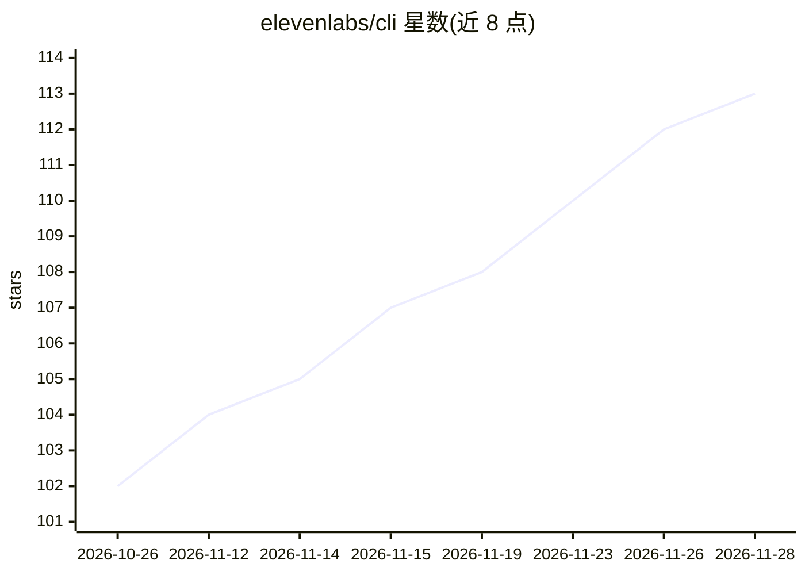

# elevenlabs/cli

⭐ 113 · Rust · MIT · 推送 2026-11-26 · [GitHub](https://github.com/elevenlabs/cli) · [官网](https://www.elevenlabs.io) · 组织维护

**访问 ElevenLabs 语音平台的命令行工具：全 API 接入与 Agents as Code**

Rust 编写的 ElevenLabs 平台官方 CLI，提供两条主线：一是把 ElevenLabs 每个 API 端点映射为子命令，实现全量 API 访问，认证用 API key 或 CI/云环境下的 workload identity federation（OIDC 令牌换短时令牌）；二是 Agents as Code，将 Conversational AI agent 配置以 JSON/YAML/TOML 存于本地，支持脚手架、push/pull 无损同步、分支管理与 ASCII/Mermaid 工作流图。另含 elevenlabs say 文字转语音播放与 Flows 后台任务的轮询等待命令。

## 筛选速览

| 维度 | 判定 | 备注 |
|---|---|---|
| AI 角色 | `ai-native` | 本体是模型或模型工具 |
| 许可风险 | `permissive` | MIT |
| 部署形态 | `library` | 以包/库形式分发 |
| 模型依赖 | — | README 未给出锁定关系 |
| 硬件要求 | — | 无带数字的原话,不猜 |
| 安装摩擦 | `high` | 编译与系统依赖俱全 |
| 成熟度 | — | 结构信号不足 |

## 能力要点

- 全部 ElevenLabs API 端点映射为 `elevenlabs <resource> <method>` 子命令
- Agents as Code：本地 JSON/YAML/TOML 配置与 ElevenLabs 无损同步
- workload identity federation 支持 GitHub Actions/GCP/AWS/Azure/K8s OIDC 令牌认证
- elevenlabs say 文字转语音并调用本地播放器；agents workflow diagram 生成流程图

## 适用场景

- 在终端里朗读文本或管道输出（如构建完成提示音）
- 以配置文件方式版本化管理语音 agent 并推送到 ElevenLabs
- CI 流水线中无密钥认证调用 ElevenLabs API
- 将 agent 工作流转成流程图用于代码评审

## 场景标签

`语音合成` · 领域:内容生成

## 证据(README 行号)

> L5: Command-line interface for the ElevenLabs platform.
> L9: - **Full API access** — every ElevenLabs API endpoint is available as a subcommand (`elevenlabs <resource> <method>`
> L10: - **Agents as Code** — manage Conversational AI agents from local configuration files, with templates, branches, an
> L163: Manage Conversational AI agents from local configuration files. `elevenlabs agents init` scaffolds a project; agen

## 星数曲线

2026-10-26 102 → 2026-11-28 113（+11）

---
*卡片 v1 · prompt 1.4 · 生成 2026-11-28 · 置信度 high · 依据 README sha `84f1e0e85b39` · [字段定义](../../DATASET.md)*
