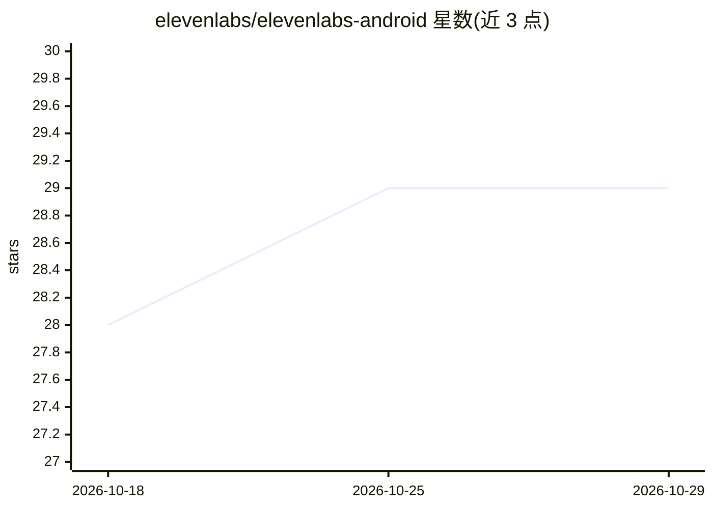

# elevenlabs/elevenlabs-android

⭐ 29 · Kotlin · MIT · 推送 2026-10-21 · [GitHub](https://github.com/elevenlabs/elevenlabs-android) · [官网](https://elevenlabs.io/) · 组织维护

**Android 版 ElevenLabs 对话 Agent 官方 Kotlin SDK**

面向 Android 开发者的官方 ElevenAgents Kotlin SDK，用于在应用中接入 ElevenLabs 对话式语音/文本 Agent。语音会话经 LiveKit（WebRTC）传输，纯文本会话走 ConvAI WebSocket 且无需麦克风权限；支持公共 agent（agentId 客户端取 token）与私有 agent（后端预签发 conversationToken 或 signedUrl），禁止在客户端内嵌 API key。提供强类型回调（转写、流式回复、VAD、音频电平、PCM 帧）、点赞/点踩反馈、静音控制与客户端工具调用（含动态工具与 sendToolResult）。通过 Maven Central 以 Gradle 依赖安装。

## 筛选速览

| 维度 | 判定 | 备注 |
|---|---|---|
| AI 角色 | `ai-ecosystem` | LLM/agent 周边工具 |
| 许可风险 | `permissive` | MIT |
| 部署形态 | `None` |  |
| 模型依赖 | — | README 未给出锁定关系 |
| 硬件要求 | — | 无带数字的原话,不猜 |
| 安装摩擦 | `low` | 无编译、无系统依赖或容器化 |
| 成熟度 | — | 结构信号不足 |

## 能力要点

- 语音走 LiveKit/WebRTC、纯文本走 ConvAI WebSocket 双传输模式
- 公共/私有 agent 三种凭据机制，强制单凭据且与传输匹配
- 丰富强类型回调：转写、流式回复、VAD、音频电平、PCM 音频帧
- 客户端工具注册与动态工具调用（onUnhandledClientToolCall + sendToolResult）

## 适用场景

- 在 Android 应用中集成 ElevenLabs 语音对话 Agent
- 构建仅文本的对话界面（无麦克风权限）
- 让 Agent 调用设备本地能力（客户端工具）
- 按区域自定义 API/WebSocket 端点满足数据驻留要求

## 场景标签

`语音 Agent` · 领域:对话与助手

## 证据(README 行号)

> L3: Official ElevenAgents SDK for Android.
> L7: - Audio‑first, low‑latency sessions over LiveKit (WebRTC)

## 星数曲线

2026-10-18 28 → 2026-10-29 29（+1）

---
*卡片 v1 · prompt 1.4 · 生成 2026-10-26 · 置信度 high · 依据 README sha `f33e7b082869` · [字段定义](../../DATASET.md)*
