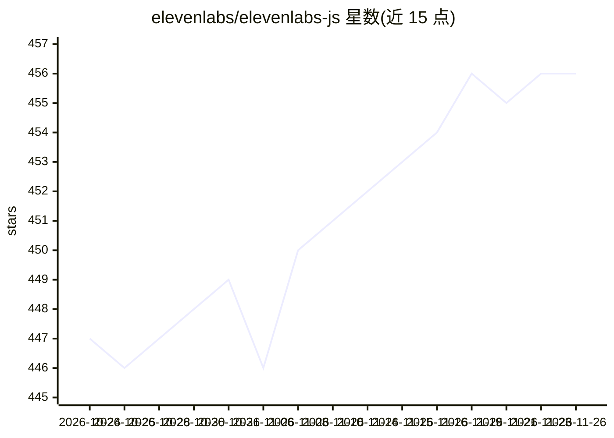

# elevenlabs/elevenlabs-js

⭐ 456 · TypeScript · MIT · 推送 2026-11-25 · [GitHub](https://github.com/elevenlabs/elevenlabs-js) · [官网](https://elevenlabs.io) · 组织维护

**面向 Node.js 开发者的 ElevenLabs API 官方 SDK**

ElevenLabs 官方 Node.js SDK，封装其语音 API：支持 TTS 模型（Eleven v4、v4 Turbo、Multilingual v2、Flash v2.5）调用、语音列表读取、音频流式传输，以及语音转文本与音乐模型入口。提供 Speech Engine 服务器搭建（可挂载到既有 HTTP 服务器或独立运行）、Workflow/Tool/Agent 的代码化定义与校验、自动重试与超时配置。音频播放需 MPV 与 ffmpeg。浏览器与 React 场景需另用 @elevenlabs/client 与 @elevenlabs/react。

## 筛选速览

| 维度 | 判定 | 备注 |
|---|---|---|
| AI 角色 | `ai-ecosystem` | LLM/agent 周边工具 |
| 许可风险 | `permissive` | MIT |
| 部署形态 | `library` | 以包/库形式分发 |
| 模型依赖 | — | README 未给出锁定关系 |
| 硬件要求 | — | 无带数字的原话,不猜 |
| 安装摩擦 | `medium` | 含编译或系统依赖之一 |
| 成熟度 | — | 结构信号不足 |

## 能力要点

- 封装 ElevenLabs 语音合成、语音列表、流式音频等 API
- Speech Engine 支持 WebSocket 会话与鉴权（含 disableAuth 选项）
- Workflow/Tool/Agent 链式代码化定义，build() 提供图校验
- 内置指数退避自动重试（默认 2 次）与 60 秒超时配置

## 适用场景

- 在 Node 应用中接入 ElevenLabs 做文本转语音
- 为自己的 LLM 对话服务添加语音能力
- 以代码方式管理语音 Agent 的工具与工作流并纳入 git

## 场景标签

`语音合成` · 领域:内容生成

## 证据(README 行号)

> L12: The official Node SDK for ElevenLabs. ElevenLabs brings the most compelling, rich and lifelike voices to creators a
> L93: Speech Engine lets you build voice-powered AI agents with a custom LLM or add voice to your existing chat agent. Th

## 星数曲线

2026-10-24 447 → 2026-11-26 456（+9）

---
*卡片 v1 · prompt 1.4 · 生成 2026-11-25 · 置信度 high · 依据 README sha `36e3dce5f949` · [字段定义](../../DATASET.md)*
