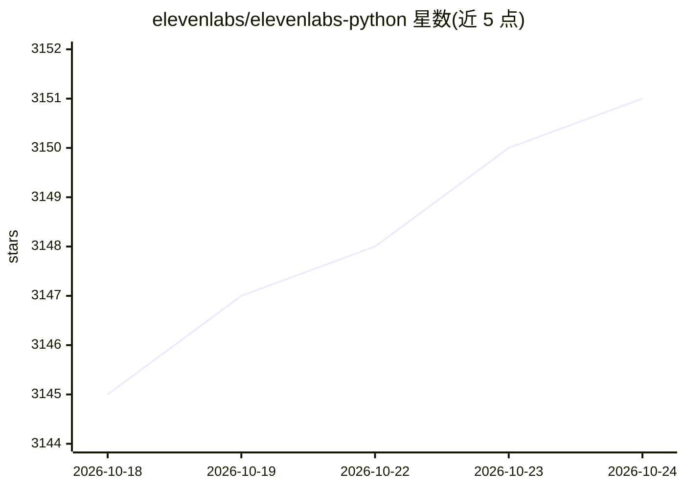

# elevenlabs/elevenlabs-python

⭐ 3,154 · Python · MIT · 推送 2026-10-20 · [GitHub](https://github.com/elevenlabs/elevenlabs-python) · [官网](https://elevenlabs.io/docs/api-reference/overview) · 组织维护

**ElevenLabs 官方 Python SDK：文本转语音与对话式语音 Agent 接入**

ElevenLabs API 的官方 Python 客户端库，覆盖 TTS 主模型（Eleven v3、Multilingual v2、Flash v2.5、Turbo v2.5）、语音克隆、实时流式音频、同步与异步客户端。另提供 ElevenAgents 构建实时语音对话 Agent（可注册自定义工具、自定义 asyncio 事件循环），以及 Speech Engine 模式：开发者侧 WebSocket 服务器接收 ElevenLabs 推送的转写，接入任意 LLM 生成回应并回传合成语音，自动检测 OpenAI/Anthropic/Gemini 流格式，内置 JWT 连接鉴权（可关闭）。使用需 ElevenLabs API key。

## 筛选速览

| 维度 | 判定 | 备注 |
|---|---|---|
| AI 角色 | `ai-ecosystem` | LLM/agent 周边工具 |
| 许可风险 | `permissive` | MIT |
| 部署形态 | `library` | 以包/库形式分发 |
| 模型依赖 | — | README 未给出锁定关系 |
| 硬件要求 | — | 无带数字的原话,不猜 |
| 安装摩擦 | `low` | 无编译、无系统依赖或容器化 |
| 成熟度 | — | 结构信号不足 |

## 能力要点

- 四个 TTS 模型接入与实时流式音频播放
- 语音克隆与语音列表/设置管理 API
- ElevenAgents 实时语音对话 Agent（自定义工具注册）
- Speech Engine：服务器端接收转写、接入任意 LLM 回传语音，自动鉴权

## 适用场景

- 在 Python 应用中调用 ElevenLabs 做文本转语音
- 构建实时语音对话 Agent 并注册自定义工具
- 搭建服务端语音代理，将 LLM 回应转成语音流

## 场景标签

`语音合成` `语音 Agent` · 领域:对话与助手

## 证据(README 行号)

> L11: The official Python SDK for ElevenLabs. ElevenLabs brings the most compelling, rich and lifelike voices to creators
> L20: pip install elevenlabs

## 星数曲线

2026-10-18 3,145 → 2026-10-24 3,151（+6）

---
*卡片 v1 · prompt 1.4 · 生成 2026-10-21 · 置信度 high · 依据 README sha `a0fb6603d4b9` · [字段定义](../../DATASET.md)*
