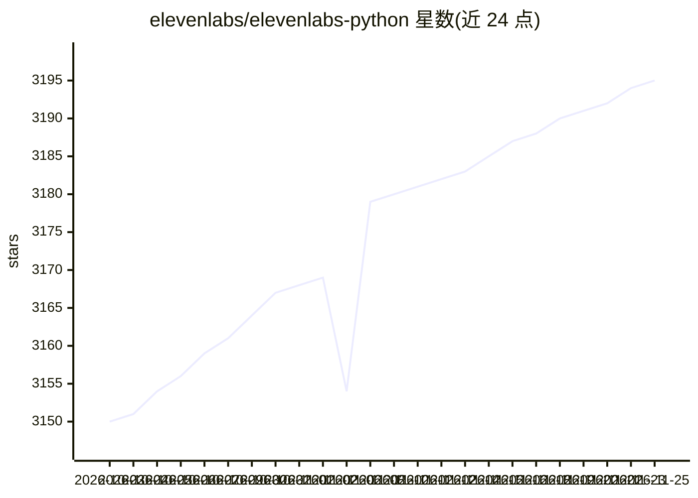

# elevenlabs/elevenlabs-python

⭐ 3,195 · Python · MIT · 推送 2026-11-23 · [GitHub](https://github.com/elevenlabs/elevenlabs-python) · [官网](https://elevenlabs.io/docs/api-reference/overview) · 组织维护

**给开发者的 ElevenLabs API 官方 Python SDK：语音合成与语音代理接入**

ElevenLabs 官方 Python SDK，通过 pip 安装后可调用其云端 API：文本转语音（支持 90+ 语言的 Eleven v4 系列与低延迟 Turbo/Flash 模型）、语音克隆、实时流式音频、异步客户端，以及 ElevenAgents 会话式语音代理（含客户端工具注册、自定义事件循环、链式 Agent 工作流与工具 schema 代码化定义）。语音克隆与 API 调用需要 API key；能力取决于 ElevenLabs 云端服务。

## 筛选速览

| 维度 | 判定 | 备注 |
|---|---|---|
| AI 角色 | `ai-ecosystem` | LLM/agent 周边工具 |
| 许可风险 | `permissive` | MIT |
| 部署形态 | `library` | 以包/库形式分发 |
| 模型依赖 | — | README 未给出锁定关系 |
| 硬件要求 | — | 无带数字的原话,不猜 |
| 安装摩擦 | `low` | 无编译、无系统依赖或容器化 |
| 成熟度 | — | 结构信号不足 |

## 能力要点

- 文本转语音与实时流式音频输出
- 语音克隆与声音搜索管理
- ElevenAgents：可注册客户端工具的会话式语音代理
- 链式 Agent 工作流/工具定义，支持 JSON 持久化与 schema 漂移检查

## 适用场景

- 为应用接入文本转语音生成有声书或旁白
- 搭建支持电话转接与条件分支的语音对话代理
- 用代码方式定义和部署 Agent 工具与工作流

## 场景标签

`语音合成` `语音 Agent` · 领域:对话与助手

## 证据(README 行号)

> L11: The official Python SDK for ElevenLabs. ElevenLabs brings the most compelling, rich and lifelike voices to creators
> L113: Build interactive AI agents with real-time audio capabilities using ElevenAgents.

## 星数曲线

2026-10-23 3,150 → 2026-11-25 3,195（+45）

---
*卡片 v1 · prompt 1.4 · 生成 2026-11-23 · 置信度 high · 依据 README sha `d23d88ad499a` · [字段定义](../../DATASET.md)*
