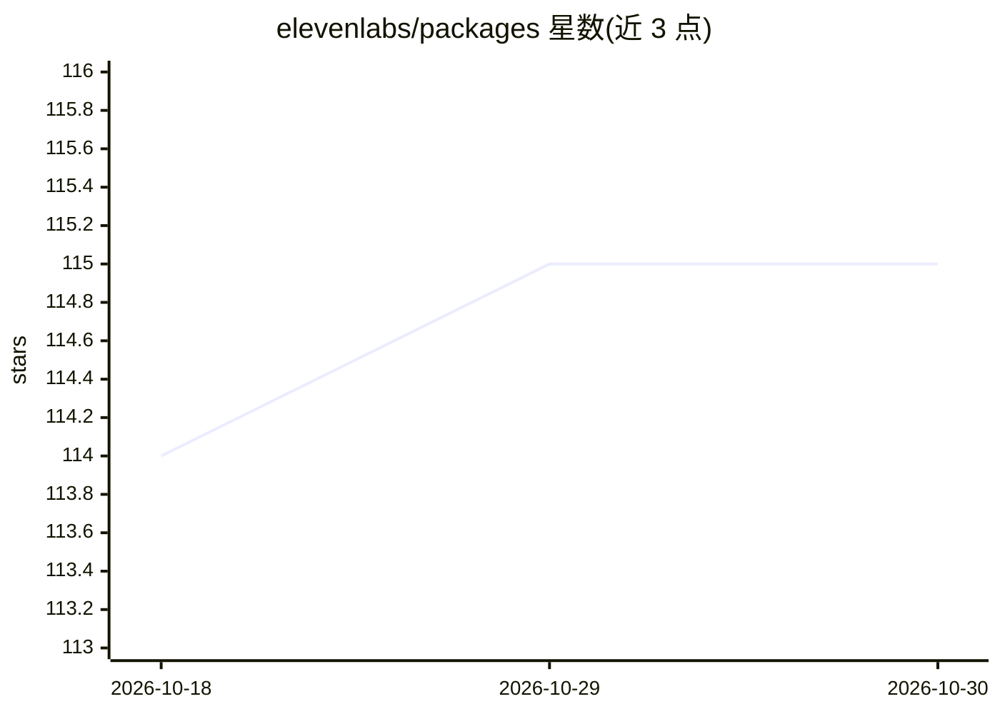

# elevenlabs/packages

⭐ 115 · TypeScript · MIT · 推送 2026-10-29 · [GitHub](https://github.com/elevenlabs/packages) · [官网](https://elevenlabs.io/docs) · 组织维护

**面向 TS/React 开发者的 ElevenLabs 多模态语音 Agent SDK**

ElevenLabs 官方维护的 monorepo，提供 5 个 npm 包：核心 TS/JS 客户端、React hooks、React Native SDK 及两个可嵌入网页的 Agent widget。基于 WebRTC 实现低延迟音频流，含事件驱动的会话生命周期管理、客户端工具（agent 触发应用内动作）、音频输入输出设备控制及公开/私有 agent 认证。React Native 需安装 LiveKit peer 依赖并配置 iOS/Android 麦克风权限。

## 筛选速览

| 维度 | 判定 | 备注 |
|---|---|---|
| AI 角色 | `ai-ecosystem` | LLM/agent 周边工具 |
| 许可风险 | `permissive` | MIT |
| 部署形态 | `library` | 以包/库形式分发 |
| 模型依赖 | — | README 未给出锁定关系 |
| 硬件要求 | — | 无带数字的原话,不猜 |
| 安装摩擦 | `low` | 无编译、无系统依赖或容器化 |
| 成熟度 | — | 结构信号不足 |

## 能力要点

- WebRTC 实时音频流式交互
- 事件驱动的 agent 会话生命周期管理与客户端工具
- React / React Native / 可嵌入 web component widget 多形态接入
- 公开与私有 agent 认证配置

## 适用场景

- 在 React/Next.js 网页中接入 ElevenLabs 语音 agent
- 构建跨平台移动端语音 agent 应用
- 以 web component 形式把 agent 嵌入任意网站

## 场景标签

`语音 Agent` · 领域:对话与助手

## 证据(README 行号)

> L5: Build multimodal agents with ElevenAgents. Our SDKs provide seamless integration with popular JavaScript/TypeScript 
> L44: - **Real-time Communication**: WebRTC-based audio streaming for low-latency agent interactions

## 星数曲线

2026-10-18 114 → 2026-10-30 115（+1）

---
*卡片 v1 · prompt 1.4 · 生成 2026-10-23 · 置信度 high · 依据 README sha `925bc99a6005` · [字段定义](../../DATASET.md)*
