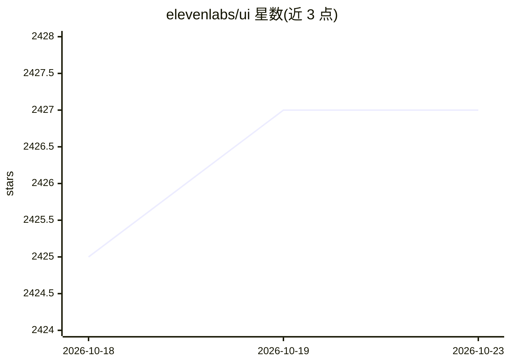

# elevenlabs/ui

⭐ 2,427 · TypeScript · MIT · 推送 2026-10-16 · [GitHub](https://github.com/elevenlabs/ui) · [官网](https://ui.elevenlabs.io) · 组织维护

**面向语音/Agent 应用的 React 组件库，基于 shadcn/ui**

ElevenLabs 维护的 React 组件库，构建于 shadcn/ui 之上，提供面向音频与 agent 应用的预构建可定制组件，包括 orb、波形、语音 agent、音频播放器等。通过 @elevenlabs/cli 或 shadcn CLI 以 npx 命令将组件添加到 Next.js 项目。使用前要求 Node.js 18+、项目已初始化 shadcn/ui 并配置 Tailwind CSS。MIT 许可。

## 筛选速览

| 维度 | 判定 | 备注 |
|---|---|---|
| AI 角色 | `ai-ecosystem` | LLM/agent 周边工具 |
| 许可风险 | `permissive` | MIT |
| 部署形态 | `library` | 以包/库形式分发 |
| 模型依赖 | — | README 未给出锁定关系 |
| 硬件要求 | — | 无带数字的原话,不猜 |
| 安装摩擦 | `low` | 无编译、无系统依赖或容器化 |
| 成熟度 | — | 结构信号不足 |

## 能力要点

- 提供 orb、波形、语音 agent、音频播放器等预构建组件
- CLI 支持一次性安装全部或单个组件到 Next.js 项目
- 兼容 shadcn/ui CLI 通过 registry 安装

## 适用场景

- 为语音 agent 应用快速搭建 UI 界面
- 在已有 shadcn/ui 项目中添加音频可视化与播放组件
- 构建带语音交互的前端原型

## 场景标签

 · 领域:前端组件库/语音 AI 应用

## 证据(README 行号)

> L5: ElevenLabs UI is a component library built on top of shadcn/ui to help you build audio & agentic applications faster
> L9: ElevenLabs UI provides pre-built, customizable React components specifically designed for agent & audio applications

## 星数曲线

2026-10-18 2,425 → 2026-10-23 2,427（+2）

---
*卡片 v1 · prompt 1.4 · 生成 2026-10-21 · 置信度 high · 依据 README sha `8876e89ef545` · [字段定义](../../DATASET.md)*
