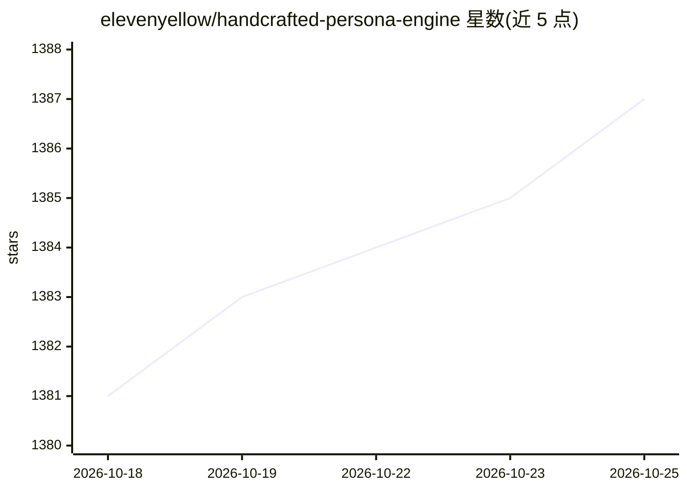

# elevenyellow/handcrafted-persona-engine

⭐ 1,387 · C# · 推送 2026-05-20 · [GitHub](https://github.com/elevenyellow/handcrafted-persona-engine) · 个人维护

**语音驱动的 Live2D 桌面虚拟角色引擎，面向 VTuber 与虚拟助手**

面向 Windows x64 + NVIDIA GPU 的 Live2D 角色引擎：麦克风音频经 Silero VAD 与双 Whisper 流水线转写，连同历史与 personality.txt 送入任意 OpenAI 兼容 LLM，回复经 Kokoro/Qwen3 TTS 合成并可选 RVC 实时变声，音素驱动 VBridger/Audio2Face 口型，情绪标签触发 Live2D 表情。内置透明悬浮窗，或经 Spout 输出到 OBS。通过 Releases 下载 zip，应用内安装器按 try/stream/build 三档 profile 下载并校验模型（约 16 GB）。CPU/AMD/Intel 不支持。

## 筛选速览

| 维度 | 判定 | 备注 |
|---|---|---|
| AI 角色 | `ai-native` | 本体是模型或模型工具 |
| 许可风险 | `none` | — |
| 部署形态 | `desktop` | 安装包/桌面程序 |
| 模型依赖 | — | README 未给出锁定关系 |
| 硬件要求 | — | 无带数字的原话,不猜 |
| 安装摩擦 | `medium` | 含编译或系统依赖之一 |
| 成熟度 | — | 结构信号不足 |

## 能力要点

- VAD + 双 Whisper 流水线：快速模型检测打断，大模型精准转写
- 任意 OpenAI 兼容端点接入，personality.txt 驱动人设
- Kokoro/Qwen3 双 TTS 引擎，可选 RVC 实时变声
- Spout 独立输出 avatar/字幕/轮盘流，免窗口捕获接入 OBS

## 适用场景

- 直播时作为 AI 共同主持或聊天反应型 VTuber 角色
- 桌面上放一个会说话、有动画的虚拟助手
- 展馆、零售等场景的交互式导览角色
- 语言练习伙伴或虚构角色沉浸对话

## 场景标签

`聊天机器人` `语音 Agent` · 领域:对话与助手

## 证据(README 行号)

> L29: Persona Engine listens through your microphone, thinks with an LLM guided by a personality file, speaks back with r
> L152: 4. **Think** — transcription + history + context + `personality.txt` go to the LLM.
> L121:  Voice in (ASR)

## 星数曲线

2026-10-18 1,381 → 2026-10-25 1,387（+6）

---
*卡片 v1 · prompt 1.4 · 生成 2026-10-21 · 置信度 high · 依据 README sha `97ae4875cbb9` · [字段定义](../../DATASET.md)*
