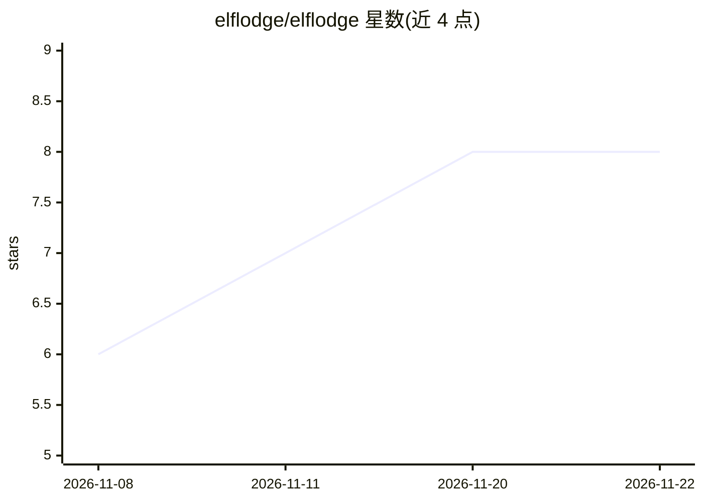

# elflodge/elflodge

⭐ 8 · TypeScript · MIT · 推送 2026-11-21 · [GitHub](https://github.com/elflodge/elflodge) · [官网](https://elflodge.com) · 个人维护

**在本地并行运行数百个沙箱 agent 的任务队列与作业 API**

以 CLI（npm 包 elflodge）与 HTTP hub 形式提供的 agent 批量作业系统：定义一次指令与 JSON Schema 输出契约，批内每个输入各成一个作业，agent（Pi）在每作业的轻量沙箱（bubblewrap/Seatbelt）内读写文件、执行 shell，返回经 schema 校验的 JSON 或带原因的失败。内置 Canary（前 5 个作业先行）与失败熔断暂停机制，支持续跑、事件日志、token 与成本统计；作业日志落盘，Runner 重启后恢复。底层是 Postgres 上的作业队列，CLI 只调 hub 的 HTTP API，API key 存于 Runner、不进入作业沙箱。

## 筛选速览

| 维度 | 判定 | 备注 |
|---|---|---|
| AI 角色 | `ai-ecosystem` | LLM/agent 周边工具 |
| 许可风险 | `permissive` | MIT |
| 部署形态 | `library` | 以包/库形式分发 |
| 模型依赖 | — | README 未给出锁定关系 |
| 硬件要求 | — | 无带数字的原话,不猜 |
| 安装摩擦 | `low` | 无编译、无系统依赖或容器化 |
| 成熟度 | `idea` | |

## 能力要点

- 批量作业共享一个 agent 定义，输出经 JSON Schema 校验，失败带原因
- Canary（前 5 作业）+ 失败率熔断，异常批次自动暂停
- 每作业轻量 OS 沙箱隔离，模型 key 不进入作业环境
- CLI 仅调 hub 的 HTTP API，hub 提供 OpenAPI 3.2 文档

## 适用场景

- 把一批发票 PDF 批量抽取成结构化 JSON 供代码使用
- 对几百条招聘启事批量提取要求与级别并输出 jsonl
- 在自己的服务器上并行跑 agent，不想为每个作业开容器或买托管沙箱

## 场景标签

`Agent 框架` `工作流自动化` · 领域:Agent 开发

## 证据(README 行号)

> L7: Run sandboxed agents in parallel on your own machine, without a costly fleet of hosted sandboxes. Send a task or a w
> L167: Underneath, it is a plain job queue whose worker happens to think: an HTTP API on Postgres (Node or Docker, or Clo

## 星数曲线

2026-11-08 6 → 2026-11-22 8（+2）

---
*卡片 v1 · prompt 1.4 · 生成 2026-11-20 · 置信度 high · 依据 README sha `0cdfb7f190b4` · [字段定义](../../DATASET.md)*
