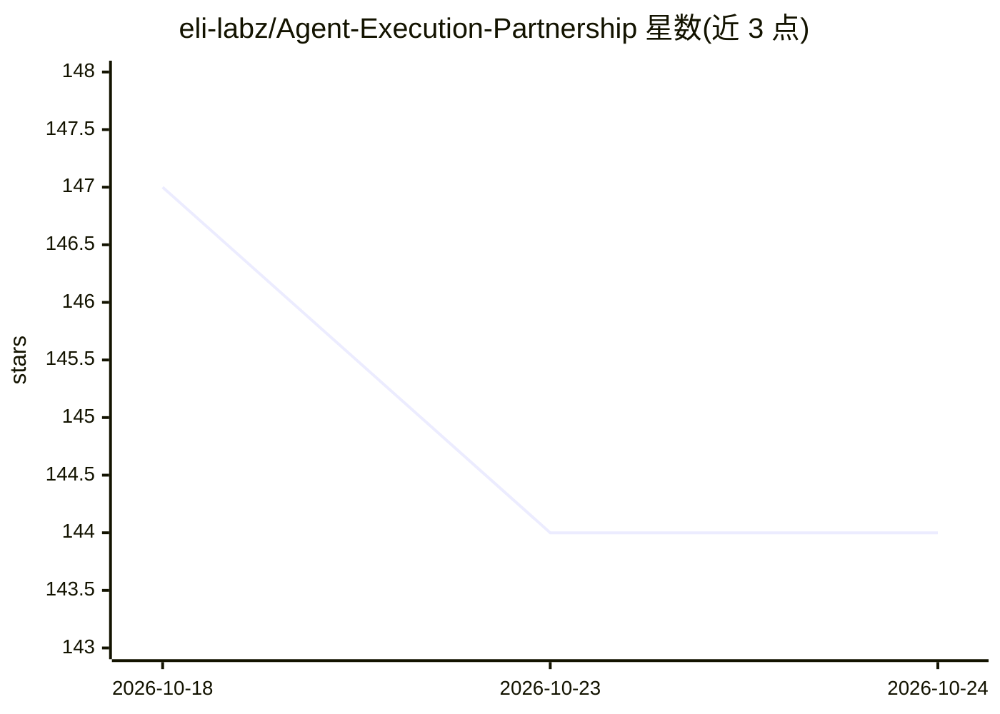

# eli-labz/Agent-Execution-Partnership

⭐ 144 · Python · NOASSERTION · 推送 2026-07-22 · [GitHub](https://github.com/eli-labz/Agent-Execution-Partnership) · [官网](https://aee.eli-labz.com/) · 个人维护

**AI agent 行动的控制平面：执行前授权、执行中可观测、执行后可验证**

面向 AI agent 执行环节的开源控制平面（AEE）：接收 agent 的行动提案，经策略评估、能力检查与风险分类后，通过适配器执行单个受限行动，并对照预期效果验证结果，失败时升级或补偿。安全机制包括默认拒绝、人工审批门、只追加的不可变审计日志；按 6 个风险等级配置控制强度。附带 Autoresearch 训练工作流与浏览器演示站点作为闭环示例。项目自述为早期实现，生产连接器默认禁用。

## 筛选速览

| 维度 | 判定 | 备注 |
|---|---|---|
| AI 角色 | `ai-ecosystem` | LLM/agent 周边工具 |
| 许可风险 | `permissive` | NOASSERTION |
| 部署形态 | `library` | 以包/库形式分发 |
| 模型依赖 | — | README 未给出锁定关系 |
| 硬件要求 | — | 无带数字的原话,不猜 |
| 安装摩擦 | `low` | 无编译、无系统依赖或容器化 |
| 成熟度 | `idea` | |

## 能力要点

- 策略评估+能力检查+风险分类的行动执行闭环
- 默认拒绝、人工审批门、不可变追加式审计日志
- 6 级风险等级（READ_ONLY 到 PHYSICAL_OR_SAFETY_RELATED）
- Autoresearch 训练工作流演示 20+ 次闭环周期与实验台账

## 适用场景

- 给自主 agent 的真实世界行动加授权与审批门
- 为高风险操作留存不可变审计记录以备核查
- 验证 agent 执行结果是否符合预期效果并自动补偿

## 场景标签

`LLM 可观测性` · 领域:评测与运维

## 证据(README 行号)

> L7: Agent Execution Partnership AEE is an open-source control plane that ensures every AI agent action is authorized bef
> L13: The Action Execution Engine (AEE) fills that gap. It accepts a proposal from an agent, subjects it to policy evalua

## 星数曲线

2026-10-18 147 → 2026-10-24 144（-3）

---
*卡片 v1 · prompt 1.4 · 生成 2026-10-22 · 置信度 mid · 依据 README sha `601611393187` · [字段定义](../../DATASET.md)*
