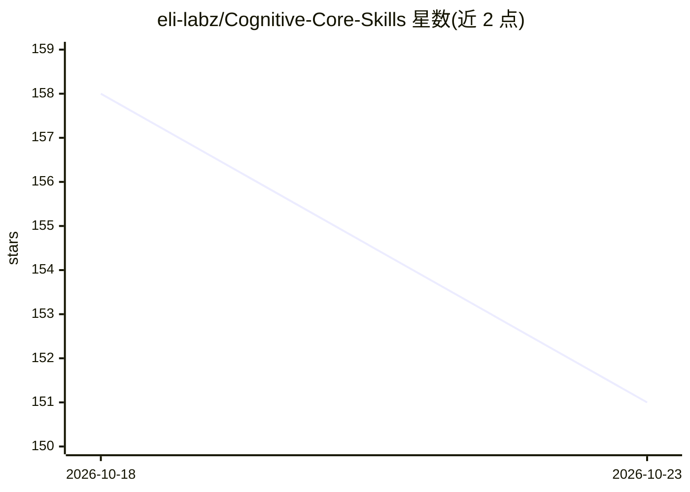

# eli-labz/Cognitive-Core-Skills

⭐ 151 · Python · MIT · 推送 2026-07-05 · [GitHub](https://github.com/eli-labz/Cognitive-Core-Skills) · 个人维护

**面向 LLM/Agent 的认知核心技能分类体系（159 张技能卡）**

行业通用的认知核心技能分类包：将感知、记忆、推理、规划、行动、验证、学习、治理八大类心智能力组织为覆盖 13 个领域、159 条技能的分类体系，面向 LLM、SLM、AI Agent 与世界模型。提供 JSON/YAML 数据、JSON Schema、生成的 markdown 技能卡、评估 rubric 基准数据及 pytest 校验与 CI；支持本地运行验证测试并可用脚本重新生成技能卡。技能卡含文本类与人类行动类技能，另含治理导向构造与认知债指数文档。

## 筛选速览

| 维度 | 判定 | 备注 |
|---|---|---|
| AI 角色 | `ai-knowledge` | 知识聚合/清单类 |
| 许可风险 | `permissive` | MIT |
| 部署形态 | `None` |  |
| 模型依赖 | — | README 未给出锁定关系 |
| 硬件要求 | — | 无带数字的原话,不猜 |
| 安装摩擦 | `low` | 无编译、无系统依赖或容器化 |
| 成熟度 | — | 结构信号不足 |

## 能力要点

- 159 条技能、13 个领域的分类体系（taxonomy v1.0.0）
- JSON/YAML/Schema/markdown 技能卡多格式机器可读产物
- pytest 校验测试与 taxonomy CI 流水线
- 包含人类行动技能与治理导向构造（如后果理解、长程规划）

## 适用场景

- 为自己的 agent 技术栈引入一套认知技能分类与技能卡
- 评估 LLM/Agent 在认知技能上的覆盖范围
- 基于 Schema 与数据文件扩展自定义技能并保持一致性

## 场景标签

 · 领域:AI 知识工程/Agent 认知架构

## 证据(README 行号)

> L20: This repository contains a universal, industry-neutral taxonomy package for:
> L35: - Reusable: JSON, YAML, and markdown skill cards for easy integration.

## 星数曲线

2026-10-18 158 → 2026-10-23 151（-7）

---
*卡片 v1 · prompt 1.4 · 生成 2026-10-22 · 置信度 high · 依据 README sha `151ecd247804` · [字段定义](../../DATASET.md)*
