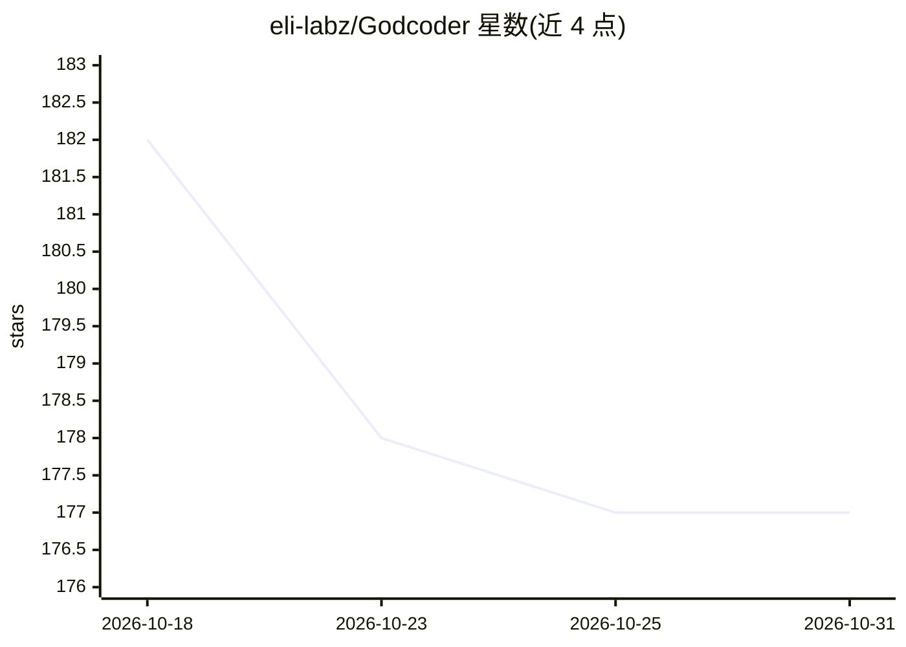

# eli-labz/Godcoder

⭐ 177 · Rust · NOASSERTION · 推送 2026-08-31 · [GitHub](https://github.com/eli-labz/Godcoder) · 个人维护

**本地优先的开源桌面 AI 编程 Agent，自带密钥**

基于 Rust agent 核心 + Tauri 2/React 桌面壳的本地优先开源编程 Agent。API 请求从本机直达用户配置的模型提供方（OpenAI/Anthropic/任意 OpenAI 兼容端点），代码不经第三方后端。提供 Ask/Plan/Coding/Freestyle/Harness/CoWork 六种模式：Harness 模式下 agent 自建并迭代自己的 harness；CoWork 模式通过 Open Cowork 桌面应用执行 GUI/OS 级人类操作任务。可选 Context Engine（tree-sitter + Qdrant + FalkorDB + BM25）做图感知代码检索，另有 headless 基准测试 runner。目前需从源码构建，CI 已产出安装包。

## 筛选速览

| 维度 | 判定 | 备注 |
|---|---|---|
| AI 角色 | `ai-native` | 本体是模型或模型工具 |
| 许可风险 | `permissive` | NOASSERTION |
| 部署形态 | `self-host` | docker 或自建部署 |
| 模型依赖 | local-ok | 支持本地模型 |
| 硬件要求 | — | 无带数字的原话,不猜 |
| 安装摩擦 | `low` | 无编译、无系统依赖或容器化 |
| 成熟度 | — | 结构信号不足 |

## 能力要点

- API 请求本机直达模型提供方，代码不经过中间后端
- Harness 模式：agent 在沙箱中自建并优化自己的 harness
- CoWork 模式：自训练驱动 Open Cowork 执行点击/输入等 GUI 自动化任务
- 可选 Context Engine：tree-sitter/Qdrant/FalkorDB/BM25 图感知代码检索
- 支持 MCP server（stdio/streamable HTTP/SSE）扩展工具集

## 适用场景

- 本地配置 API key 让 AI 直接修改我的代码库
- 让 agent 通过 GUI 自动化完成办公软件里的人类操作任务
- 对同一 agent 核心跨模型跑 headless 基准测试

## 场景标签

`编码 Agent` `GUI 自动化` · 领域:效率与自动化

## 证据(README 行号)

> L17: Godcoder is a **local-first, fully open-source AI coding agent** that runs as a native desktop app. Unlike cloud-ba
> L19: It goes beyond editing code: Godcoder can **build and continuously improve its own agent harness** (Harness mode) a
> L61: |🔌 **Any LLM Provider**|Plug in OpenAI, Anthropic, or any OpenAI-compatible endpoint — no proxy needed|

## 星数曲线

2026-10-18 182 → 2026-10-31 177（-5）

---
*卡片 v1 · prompt 1.4 · 生成 2026-10-22 · 置信度 mid · 依据 README sha `104a228f07ef` · [字段定义](../../DATASET.md)*
