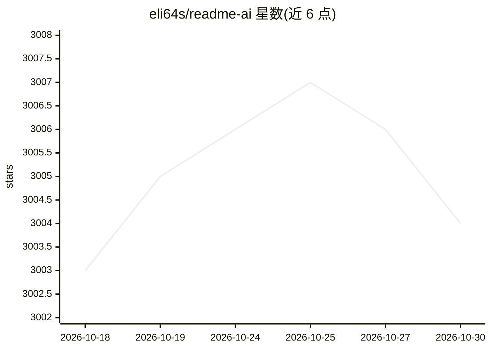

# eli64s/readme-ai

⭐ 3,004 · Python · MIT · 推送 2026-10-28 · [GitHub](https://github.com/eli64s/readme-ai) · [官网](https://eli64s.github.io/readme-ai/) · 个人维护

**面向开发者的 README 自动生成 CLI 工具**

ReadmeAI 是一个命令行开发工具：提供仓库 URL 或本地路径，经仓库解析引擎提取依赖、结构、用法等信息，调用 LLM 生成结构化 README 文件。支持 OpenAI、Anthropic、Google Gemini、Ollama 等多种 LLM 服务及无 LLM 的离线模式，可自定义模板、徽章、头部样式，支持文件系统、GitHub、GitLab、Bitbucket 仓库来源。通过 pip/pipx/uv/Docker/源码安装，需 Python 3.10+。

## 筛选速览

| 维度 | 判定 | 备注 |
|---|---|---|
| AI 角色 | `ai-native` | 本体是模型或模型工具 |
| 许可风险 | `permissive` | MIT |
| 部署形态 | `self-host` | docker 或自建部署 |
| 模型依赖 | local-ok | 支持本地模型 |
| 硬件要求 | — | 无带数字的原话,不猜 |
| 安装摩擦 | `low` | 无编译、无系统依赖或容器化 |
| 成熟度 | — | 结构信号不足 |

## 能力要点

- 提供 URL 或路径即可生成 README，支持四种头部样式与多种徽章/导航/emoji 自定义
- 模型无关：支持 OpenAI、Anthropic、Google Gemini、Ollama 及离线模式
- 支持文件系统、GitHub、GitLab、Bitbucket 四类仓库来源
- 智能文件过滤（.readmeaiignore 模式）

## 适用场景

- 为新项目快速生成结构完整的 README
- 用本地 Ollama 模型离线生成文档
- 统一团队各项目的 README 风格与徽章样式

## 场景标签

`AI 写作` · 领域:内容生成

## 证据(README 行号)

> L32: ReadmeAI is a developer tool that automatically generates README files using a robust repository processing engine 
> L227: ReadmeAI is model agnostic, with support for the following LLM API services:

## 星数曲线

2026-10-18 3,003 → 2026-10-30 3,004（+1）

---
*卡片 v1 · prompt 1.4 · 生成 2026-10-20 · 置信度 high · 依据 README sha `a69a01e47425` · [字段定义](../../DATASET.md)*
