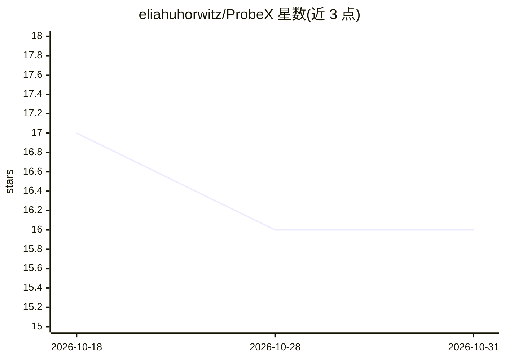

# eliahuhorwitz/ProbeX

⭐ 16 · Python · 推送 2026-02-11 · [GitHub](https://github.com/eliahuhorwitz/ProbeX) · [官网](https://horwitz.ai/probex) · 组织维护

**CVPR 2025 论文官方实现：从模型权重预测训练类别**

"Learning on Model Weights using Tree Experts" 的官方 PyTorch 实现，提出 Probing Experts (ProbeX) 方法：仅从模型单个隐藏层的权重学习，预测模型训练数据集的类别。基于 Model Trees 观察（同一微调树内干扰变化更小），用轻量探测替代昂贵的线性分类器；可将 Stable Diffusion 权重映射到与语言对齐的嵌入空间，支持零样本模型分类（文本搜模型）。提供数据集下载、判别/生成训练与下游评测脚本，面向科研复现。

## 筛选速览

| 维度 | 判定 | 备注 |
|---|---|---|
| AI 角色 | `ai-native` | 本体是模型或模型工具 |
| 许可风险 | `none` | — |
| 部署形态 | `library` | 以包/库形式分发 |
| 模型依赖 | — | README 未给出锁定关系 |
| 硬件要求 | — | 无带数字的原话,不猜 |
| 安装摩擦 | `low` | 无编译、无系统依赖或容器化 |
| 成熟度 | — | 结构信号不足 |

## 能力要点

- 从单个隐藏层权重学习，预测模型训练数据类别
- 将 Stable Diffusion 权重映射入语言嵌入空间，支持文本零样本模型分类
- 配套 Model-J 数据集（判别/生成 LoRA 子集）下载脚本
- 支持多层训练分布到多 GPU（sbatch 示例）

## 适用场景

- 复现论文中基于权重的模型分类实验
- 为无文档的开源模型推断训练数据类别
- 按文本描述在模型库中检索候选模型

## 场景标签

`科研工具` · 领域:学习与行业

## 证据(README 行号)

> L2: Official PyTorch Implementation for the "Learning on Model Weights using Tree Experts" paper (CVPR 2025).
> L20: > *Probing Experts* (ProbeX), a theoretically motivated and lightweight method. Notably, ProbeX is the first
> L22: > We demonstrate the effectiveness of ProbeX by predicting the categories in a model's training dataset based only

## 星数曲线

2026-10-18 17 → 2026-10-31 16（-1）

---
*卡片 v1 · prompt 1.4 · 生成 2026-10-30 · 置信度 mid · 依据 README sha `202aedb072a9` · [字段定义](../../DATASET.md)*
