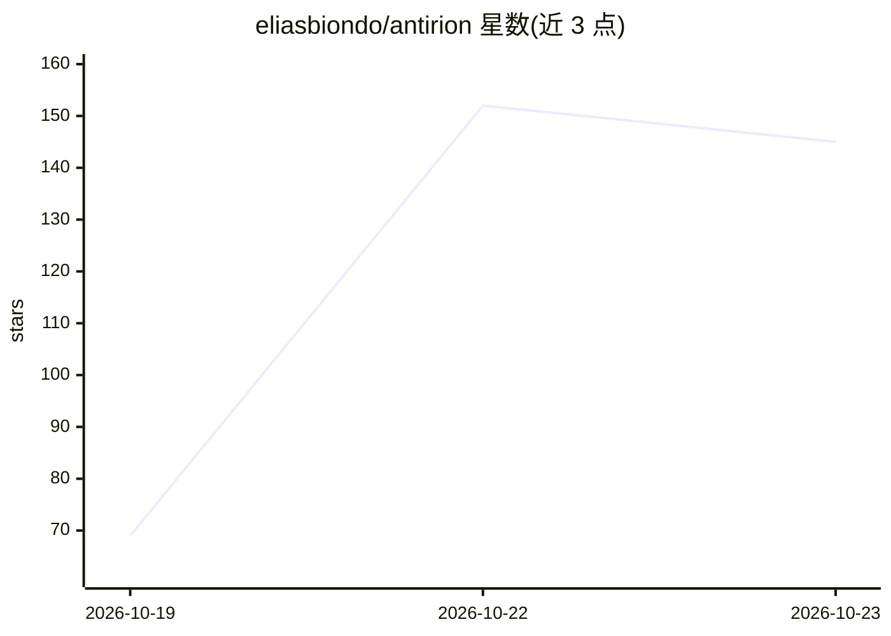

# eliasbiondo/antirion

⭐ 145 · Rust · Apache-2.0 · 推送 2026-10-18 · [GitHub](https://github.com/eliasbiondo/antirion) · [官网](https://antirion.ai) · 个人维护

**单二进制 Rust LLM 网关：统一接入多家模型商并路由计费**

面向开发与运维团队的 LLM API 网关：以单个 Rust 二进制（或 distroless 镜像）提供网关、Admin API 与内置 Web 控制台。支持 OpenAI、Azure OpenAI、Anthropic、Bedrock、Vertex AI、Gemini、Mistral、Cohere、Groq、DeepSeek 等提供商及 OpenAI/Anthropic 兼容服务器（如 vLLM），并在不同 API 格式间转换。提供回退链、加权分流、重试、熔断等路由策略，组织/团队/项目/密钥级的美元或 token 限额，PII/密钥/正则等护栏，精确与语义缓存，MCP 与 agent 网关，SSO（OIDC/SAML/SCIM）。可单节点内嵌存储运行，或以 PostgreSQL 与 Valkey 组集群；提供 Docker 镜像、Helm Chart 与 Linux 二进制。macOS/Windows 需运行容器或从源码构建。

## 筛选速览

| 维度 | 判定 | 备注 |
|---|---|---|
| AI 角色 | `ai-ecosystem` | LLM/agent 周边工具 |
| 许可风险 | `permissive` | Apache-2.0 |
| 部署形态 | `self-host` | docker 或自建部署 |
| 模型依赖 | local-ok | 支持本地模型 |
| 硬件要求 | — | 无带数字的原话,不猜 |
| 安装摩擦 | `low` | 无编译、无系统依赖或容器化 |
| 成熟度 | — | 结构信号不足 |

## 能力要点

- 网关、Admin API 与 Web 控制台打包为单个 Rust 二进制
- 20+ 提供商统一 API，客户端可说 OpenAI/Anthropic/Gemini/Bedrock 协议
- 回退、加权、最低成本/延迟等路由与多级预算限额、成本台账
- 护栏（PII/密钥/正则/JSON schema/工具权限）、语义缓存、MCP 与 agent 网关、SSO

## 适用场景

- 团队统一管理多家模型提供商的密钥、模型与调用
- 按组织/团队/项目控制 LLM 支出预算并审计请求
- 在多个提供商之间做回退与分流保障服务可用性

## 场景标签

`模型网关` · 领域:Agent 开发

## 证据(README 行号)

> L7: One Rust binary, with the admin console built in, between your apps and every model provider.
> L36: - **Every major provider behind one API.** OpenAI, Azure OpenAI, Anthropic, Amazon Bedrock,
> L39:  speak OpenAI, Anthropic, Gemini or Bedrock; Antirion translates between them.

## 星数曲线

2026-10-19 69 → 2026-10-23 145（+76）

---
*卡片 v1 · prompt 1.4 · 生成 2026-10-22 · 置信度 mid · 依据 README sha `93c61cc434af` · [字段定义](../../DATASET.md)*
