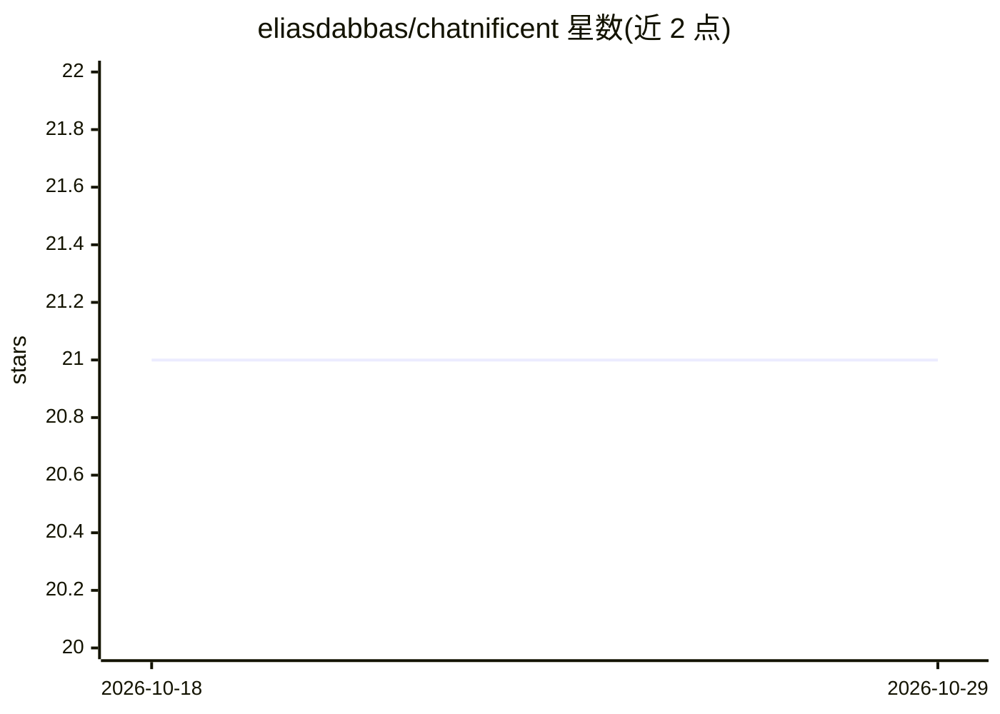

# eliasdabbas/chatnificent

⭐ 21 · Python · 推送 2026-06-04 · [GitHub](https://github.com/eliasdabbas/chatnificent) · [官网](https://chatnificent.com) · 个人维护

**面向 Python 开发者的可替换组件式 LLM 聊天应用框架**

Python 框架，用于构建 LLM 聊天应用：将服务器、UI、LLM 客户端、存储、编排、认证、工具调用、检索、路由 9 个关注点拆为独立可替换的支柱组件，默认零依赖即可用内置 Echo LLM 与 stdlib 服务器启动，安装 openai SDK 后自动检测接入。LLM 支柱提供 OpenAI、Anthropic、Gemini、OpenRouter、DeepSeek、Ollama 等实现；默认流式输出（SSE），二进制输出（音频/图像/PDF）自动落盘并在浏览器内渲染。examples 目录提供 31 个独立脚本。

## 筛选速览

| 维度 | 判定 | 备注 |
|---|---|---|
| AI 角色 | `ai-ecosystem` | LLM/agent 周边工具 |
| 许可风险 | `none` | — |
| 部署形态 | `library` | 以包/库形式分发 |
| 模型依赖 | local-ok | 支持本地模型 |
| 硬件要求 | — | 无带数字的原话,不猜 |
| 安装摩擦 | `low` | 无编译、无系统依赖或容器化 |
| 成熟度 | — | 结构信号不足 |

## 能力要点

- 9 支柱架构：LLM/存储/UI/服务器等组件独立替换
- 零依赖启动：内置 Echo LLM + stdlib HTTP 服务器
- LLM 支柱提供 OpenAI/Anthropic/Gemini/OpenRouter/DeepSeek/Ollama 实现
- 二进制输出（音频/图像/PDF）自动持久化并以 HTML5 播放器渲染

## 适用场景

- 快速搭建可深度定制的 LLM 聊天应用，替换任意组件而不重写
- 构建带工具调用、RAG 检索与多用户存储的对话应用
- 通过单文件示例学习 LLM 应用的图像、TTS、搜索等模式

## 场景标签

`RAG` · 领域:知识与检索

## 证据(README 行号)

> L56: **LLM chat app framework. Minimally complete. Maximally hackable.**
> L62: Chatnificent is a Python framework where each of those concerns is an independent, swappable component. You get a w
> L147: Every major function is handled by an independent pillar with an abstract interface:

## 星数曲线

2026-10-18 21 → 2026-10-29 21（+0）

---
*卡片 v1 · prompt 1.4 · 生成 2026-10-28 · 置信度 high · 依据 README sha `4b9e62ee6a65` · [字段定义](../../DATASET.md)*
