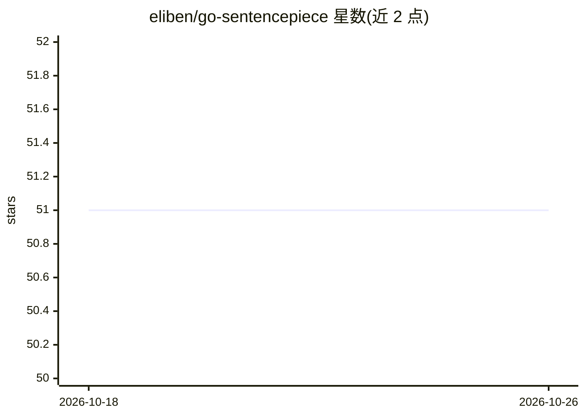

# eliben/go-sentencepiece

⭐ 51 · Go · Apache-2.0 · 推送 2025-12-10 · [GitHub](https://github.com/eliben/go-sentencepiece) · 个人维护

**SentencePiece 分词器的纯 Go 实现，面向 Gemma 模型**

用纯 Go 实现 SentencePiece 文本的编码（文本切分为 token）与解码（token 还原为文本），当前仅实现 BPE 分词，目标是复现 Gemma 模型的分词行为（同款分词器亦用于 Google 的 Gemini 系列）。分词器的 protobuf 配置文件不在仓库内，需从 Gemma 官方仓库获取 tokenizer.model；已对照 SentencePiece Python 绑定进行测试。另有编译为 WebAssembly 的浏览器在线演示。面向需要在 Go 程序中做 tokenization 的开发者。

## 筛选速览

| 维度 | 判定 | 备注 |
|---|---|---|
| AI 角色 | `ai-ecosystem` | LLM/agent 周边工具 |
| 许可风险 | `permissive` | Apache-2.0 |
| 部署形态 | `None` |  |
| 模型依赖 | — | README 未给出锁定关系 |
| 硬件要求 | — | 无带数字的原话,不猜 |
| 安装摩擦 | `low` | 无编译、无系统依赖或容器化 |
| 成熟度 | — | 结构信号不足 |

## 能力要点

- 纯 Go 实现 SentencePiece 编码/解码，无需 CGO
- 仅实现 BPE 分词，复现 Gemma 模型的分词结果
- 已对照 SentencePiece Python 绑定进行系统测试
- 提供编译为 WebAssembly 的浏览器在线演示

## 适用场景

- 在 Go 程序中对文本执行 Gemma 同款 BPE 分词与还原
- 为 Go 语言实现的 LLM 推理或处理流水线提供 tokenization 环节
- 在浏览器中交互式查看文本的分词结果

## 场景标签

 · 领域:LLM 基础设施/分词

## 证据(README 行号)

> L7: This is a pure Go implementation of encoding and decoding text with
> L16: on implementing just the functionality required to reproduce the

## 星数曲线

2026-10-18 51 → 2026-10-26 51（+0）

---
*卡片 v1 · prompt 1.4 · 生成 2026-10-24 · 置信度 high · 依据 README sha `ea02df750cbb` · [字段定义](../../DATASET.md)*
