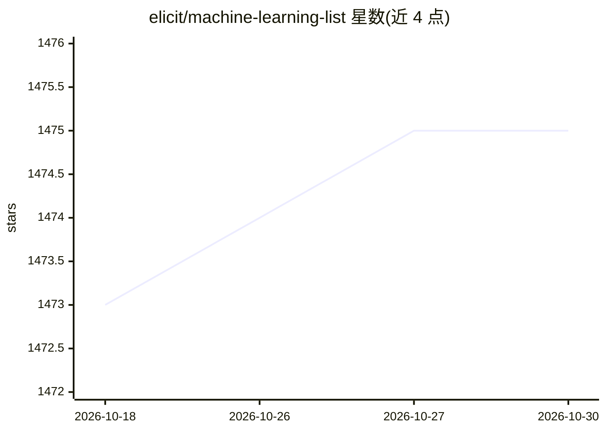

# elicit/machine-learning-list

⭐ 1,475 · 推送 2025-11-27 · [GitHub](https://github.com/elicit/machine-learning-list) · [官网](https://elicit.com/careers) · 组织维护

**面向新员工的基础模型论文与教程分级阅读清单**

Elicit 维护的机器学习学习课程，以论文和视频为主，聚焦语言模型：按基础知识、Transformer、基础模型架构、训练与微调、推理与运行时策略（上下文推理、任务分解、辩论、工具使用、事实性）及科学应用等主题组织。每个主题内按 Tier 1-4+ 分层给出推荐阅读顺序，2025/11/26 后新增条目以星标标记。定位是帮助新入职员工建立 ML 背景，兼顾生产部署相关论文与长期可扩展性技术，非软件产品，无安装运行内容。

## 筛选速览

| 维度 | 判定 | 备注 |
|---|---|---|
| AI 角色 | `ai-knowledge` | 知识聚合/清单类 |
| 许可风险 | `none` | — |
| 部署形态 | `None` |  |
| 模型依赖 | — | README 未给出锁定关系 |
| 硬件要求 | — | 无带数字的原话,不猜 |
| 安装摩擦 | `low` | 无编译、无系统依赖或容器化 |
| 成熟度 | — | 结构信号不足 |

## 能力要点

- 按主题组织的分级（Tier 1-4+）论文/教程清单
- 覆盖 Transformer、基础模型架构、训练微调、推理策略、工具使用与事实性等主题
- 2025/11/26 后新增条目带星标，跟踪 DeepSeek-R1/V3、Llama 3、Qwen2.5 等新报告

## 适用场景

- 系统自学语言模型与基础模型的研究脉络
- 新入职 ML 工程师按顺序建立背景知识
- 查找生产部署与可扩展性相关的经典论文

## 场景标签

`教程课程` `精选清单` · 领域:学习与行业

## 证据(README 行号)

> L5: The purpose of this curriculum is to help new Elicit employees learn background in machine learning, with a focus on
> L21: ## Fundamentals

## 星数曲线

2026-10-18 1,473 → 2026-10-30 1,475（+2）

---
*卡片 v1 · prompt 1.4 · 生成 2026-10-21 · 置信度 high · 依据 README sha `3c4f3368e513` · [字段定义](../../DATASET.md)*
