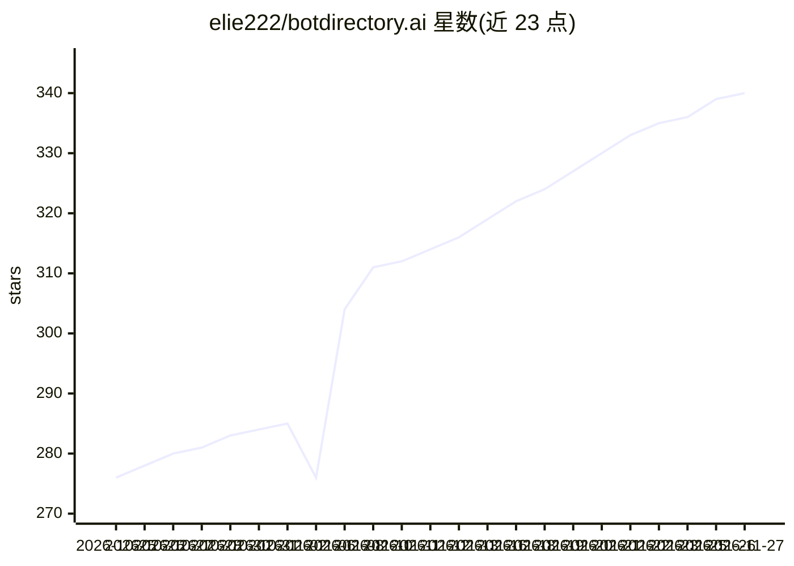

# elie222/botdirectory.ai

⭐ 340 · Astro · MIT · 推送 2026-11-26 · [GitHub](https://github.com/elie222/botdirectory.ai) · [官网](https://botdirectory.ai) · 组织维护

**面向 agent 用户的社区机器人提示词目录站**

社区维护的 agent 提示词目录：每个 bot 是 bots/ 目录下的一个 markdown 文件，用户复制提示词粘贴到自己的 agent 中，使其配置为定时机器人，覆盖邮件分拣、每日简报、SEO 修复、流失预警等任务。贡献方式包括 fork 仓库提交 PR（CI 校验）或在 X 上 @botdirectoryai 由 bot 代开 PR。提供公开读写 API（分页查询、游标同步、账号注册、以 API 写入自动开 PR）、原始 JSON feed 与本地开发指南（Astro + pnpm）。

## 筛选速览

| 维度 | 判定 | 备注 |
|---|---|---|
| AI 角色 | `ai-knowledge` | 知识聚合/清单类 |
| 许可风险 | `permissive` | MIT |
| 部署形态 | `library` | 以包/库形式分发 |
| 模型依赖 | — | README 未给出锁定关系 |
| 硬件要求 | — | 无带数字的原话,不猜 |
| 安装摩擦 | `low` | 无编译、无系统依赖或容器化 |
| 成熟度 | — | 结构信号不足 |

## 能力要点

- 一个 bot = 一个 markdown 文件，CI 校验后合入即上线
- 公开读写 API：分页查询、cursor 增量同步、JSON 全量 feed
- 通过 API 写入会自动开 PR，不直接推送 main
- 支持在 X 上 @botdirectoryai 由 bot 代为提交

## 适用场景

- 为自己的 agent 挑选现成的定时任务提示词
- 把我的 bot 提示词贡献进目录并暴露给检索
- 通过公开 API 镜像或同步整个目录数据

## 场景标签

`提示工程` · 领域:Agent 开发

## 证据(README 行号)

> L3: A community-maintained directory of ready-to-use agent prompts for Grok Bot,
> L14: A bot is one markdown file in `bots/`:

## 星数曲线

2026-10-25 276 → 2026-11-27 340（+64）

---
*卡片 v1 · prompt 1.4 · 生成 2026-11-25 · 置信度 high · 依据 README sha `3dbb776dfd93` · [字段定义](../../DATASET.md)*
