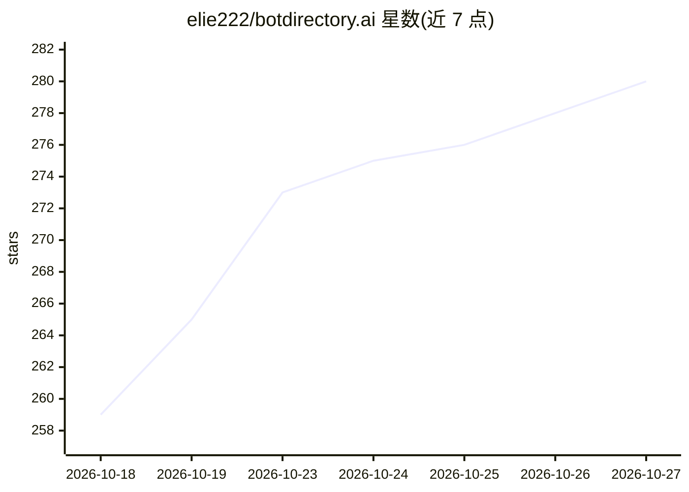

# elie222/botdirectory.ai

⭐ 280 · Astro · MIT · 推送 2026-10-26 · [GitHub](https://github.com/elie222/botdirectory.ai) · [官网](https://botdirectory.ai) · 组织维护

**社区维护的 agent 机器人提示词目录网站**

收录可直接复制使用的 agent 提示词（每个 bot 一个 markdown 文件），覆盖邮件分诊、每日简报、SEO、流失预警等场景，面向 Grok Bot、Rakazo 等任意 agent 用户。贡献方式为 fork 后提交 PR 或在 X 上 @botdirectoryai 由 mention bot 代开 PR，CI 校验后上线。提供公共读写 API（分页列表、cursor 同步、bots.json 全量镜像 feed、updates.json 摘要 feed、API key 写入）。本地开发为 Astro 静态站点 + TypeScript + pnpm，MIT 许下由 Inbox Zero Inc. 维护。

## 筛选速览

| 维度 | 判定 | 备注 |
|---|---|---|
| AI 角色 | `ai-knowledge` | 知识聚合/清单类 |
| 许可风险 | `permissive` | MIT |
| 部署形态 | `library` | 以包/库形式分发 |
| 模型依赖 | — | README 未给出锁定关系 |
| 硬件要求 | — | 无带数字的原话,不猜 |
| 安装摩擦 | `low` | 无编译、无系统依赖或容器化 |
| 成熟度 | — | 结构信号不足 |

## 能力要点

- 每 bot 一个 markdown 文件，PR/mention bot/写 API 三种贡献方式
- 公共 API 支持分页、cursor 同步与全量镜像 feed
- 支持 Grok Bot share link 的 Add to Grok Bot 直达（不重托管配置）
- Astro 静态站点，CI 校验 bots/ 目录文件

## 适用场景

- 为我的 agent 找现成的定时机器人提示词
- 提交自己写的 agent 提示词获得曝光
- 通过 API 镜像或增量同步整个目录数据

## 场景标签

`精选清单` · 领域:学习与行业

## 证据(README 行号)

> L3: A community-maintained directory of ready-to-use agent prompts for Grok Bot,
> L14: A bot is one markdown file in `bots/`:

## 星数曲线

2026-10-18 259 → 2026-10-27 280（+21）

---
*卡片 v1 · prompt 1.4 · 生成 2026-10-22 · 置信度 high · 依据 README sha `c965606103bc` · [字段定义](../../DATASET.md)*
