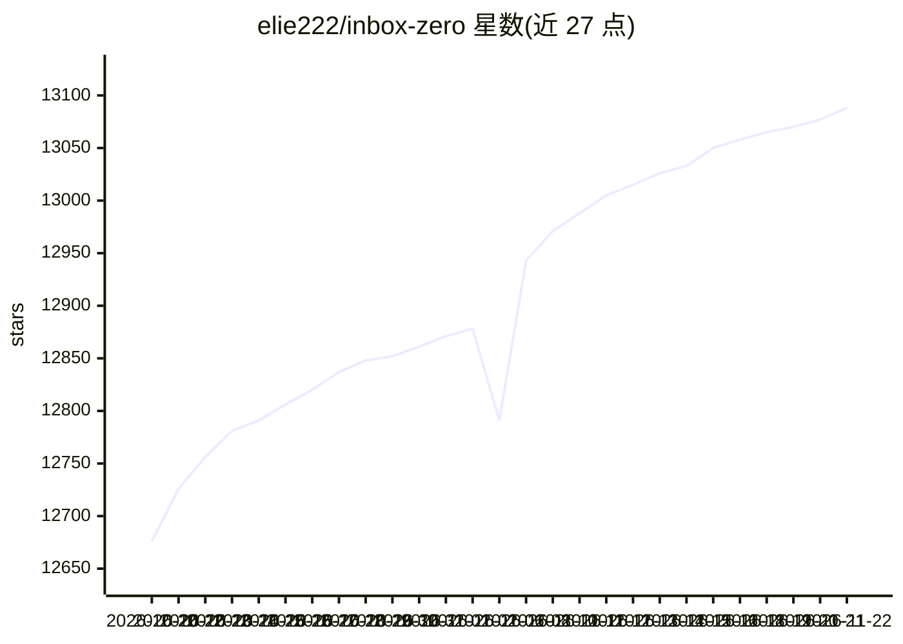

# elie222/inbox-zero

⭐ 13,088 · TypeScript · NOASSERTION · 推送 2026-11-21 · [GitHub](https://github.com/elie222/inbox-zero) · [官网](https://getinboxzero.com) · 个人维护

**开源 AI 邮件助手：助你更快清空收件箱**

面向 Gmail 与 Outlook 用户的邮件管理应用，包含两部分：后台运行的 AI 邮件助手和独立邮件客户端。AI 助手支持用自然语言设置规则、按用户风格预起草回复、批量退订与归档、拦截冷邮件、生成会议简报，并可通过 Slack/Telegram 对话管理邮箱。客户端支持 Gmail/Outlook 多账户合一；桌面端为 Electron 应用，iOS 应用暂未开源。提供托管版，也可用 npx CLI 或源码自托管，自托管需 Docker 与 Node.js v24+。

## 筛选速览

| 维度 | 判定 | 备注 |
|---|---|---|
| AI 角色 | `ai-native` | 本体是模型或模型工具 |
| 许可风险 | `none` | NOASSERTION |
| 部署形态 | `library` | 以包/库形式分发 |
| 模型依赖 | — | README 未给出锁定关系 |
| 硬件要求 | — | 无带数字的原话,不猜 |
| 安装摩擦 | `low` | 无编译、无系统依赖或容器化 |
| 成熟度 | — | 结构信号不足 |

## 能力要点

- AI 助手：自然语言规则整理收件箱，按用户语气预起草回复
- 批量退订/归档、冷邮件拦截、附件自动存至 Google Drive/OneDrive
- Slack 与 Telegram 集成，可远程管理邮箱
- 提供 npx CLI 一键自托管与本地开发环境（含 LLM 模拟器，AI 回复为预设内容）

## 适用场景

- 自动整理 Gmail/Outlook 收件箱并预起草回复
- 一键批量退订和归档不读邮件
- 通过 Slack 或 Telegram 在外出时管理邮箱
- 自托管专属 AI 邮件助理服务

## 场景标签

`AI 助手` · 领域:对话与助手

## 证据(README 行号)

> L26: Inbox Zero has two parts: an AI email assistant that works in the background on your Gmail or Outlook account, and 
> L30: - **AI Personal Assistant:** Organizes your inbox and pre-drafts replies in your tone and style.
> L31: - **AI Rules for email:** Explain in plain English how your AI should handle your inbox.

## 星数曲线

2026-10-20 12,676 → 2026-11-22 13,088（+412）

---
*卡片 v1 · prompt 1.4 · 生成 2026-11-22 · 置信度 high · 依据 README sha `50a2cffee76a` · [字段定义](../../DATASET.md)*
