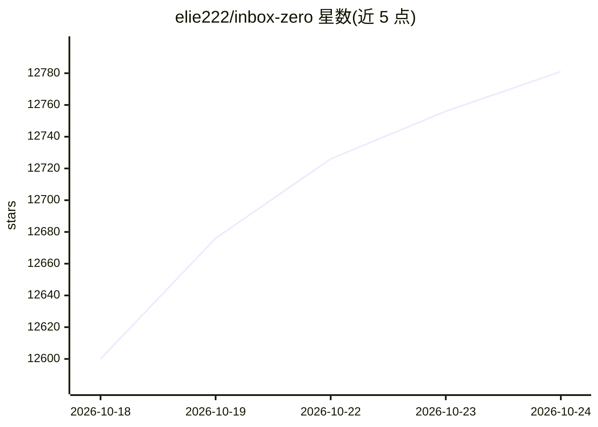

# elie222/inbox-zero

⭐ 12,791 · TypeScript · NOASSERTION · 推送 2026-10-23 · [GitHub](https://github.com/elie222/inbox-zero) · [官网](https://getinboxzero.com) · 个人维护

**开源 AI 邮件助手与邮件客户端，助用户清空收件箱**

包含两部分：后台运行于 Gmail/Outlook 账号的 AI 邮件助手（整理收件箱、按用户语气预写回复、自然语言规则、批量退订/归档、拦截陌生邮件、会议简报、附件自动存储），可通过 Slack/Telegram 对话操作；以及一个 Web/桌面（Electron）邮件客户端。提供托管版与自托管（CLI + Docker + Node.js v24+）两种方式，本地开发模式带各服务模拟器、无需 API key。自称 Fyxer 与 Superhuman 的开源替代。

## 筛选速览

| 维度 | 判定 | 备注 |
|---|---|---|
| AI 角色 | `ai-native` | 本体是模型或模型工具 |
| 许可风险 | `none` | NOASSERTION |
| 部署形态 | `library` | 以包/库形式分发 |
| 模型依赖 | — | README 未给出锁定关系 |
| 硬件要求 | — | 无带数字的原话,不猜 |
| 安装摩擦 | `low` | 无编译、无系统依赖或容器化 |
| 成熟度 | — | 结构信号不足 |

## 能力要点

- AI 助手按用户语气预写回复并用自然语言规则管理收件箱
- 支持 Gmail 与 Outlook，可从 Slack/Telegram 对话操作
- 批量退订/归档、陌生邮件拦截、会议简报、附件存 Google Drive/OneDrive
- 自托管 CLI（Docker + Node.js v24+），本地开发无需 OAuth 或 AI API key

## 适用场景

- 让 AI 自动整理收件箱并预写符合我语气的回复
- 批量退订和归档不再阅读的邮件
- 在 Slack/Telegram 里远程管理我的邮箱

## 场景标签

`AI 助手` · 领域:对话与助手

## 证据(README 行号)

> L2:  Inbox Zero - your 24/7 AI email assistant and email app
> L5:  Organizes your inbox, pre-drafts replies, manages your calendar, and organizes attachments. Chat with it from Slack
> L26: Inbox Zero has two parts: an AI email assistant that works in the background on your Gmail or Outlook account, and 

## 星数曲线

2026-10-18 12,600 → 2026-10-24 12,781（+181）

---
*卡片 v1 · prompt 1.4 · 生成 2026-10-20 · 置信度 high · 依据 README sha `e84b6a242c50` · [字段定义](../../DATASET.md)*
