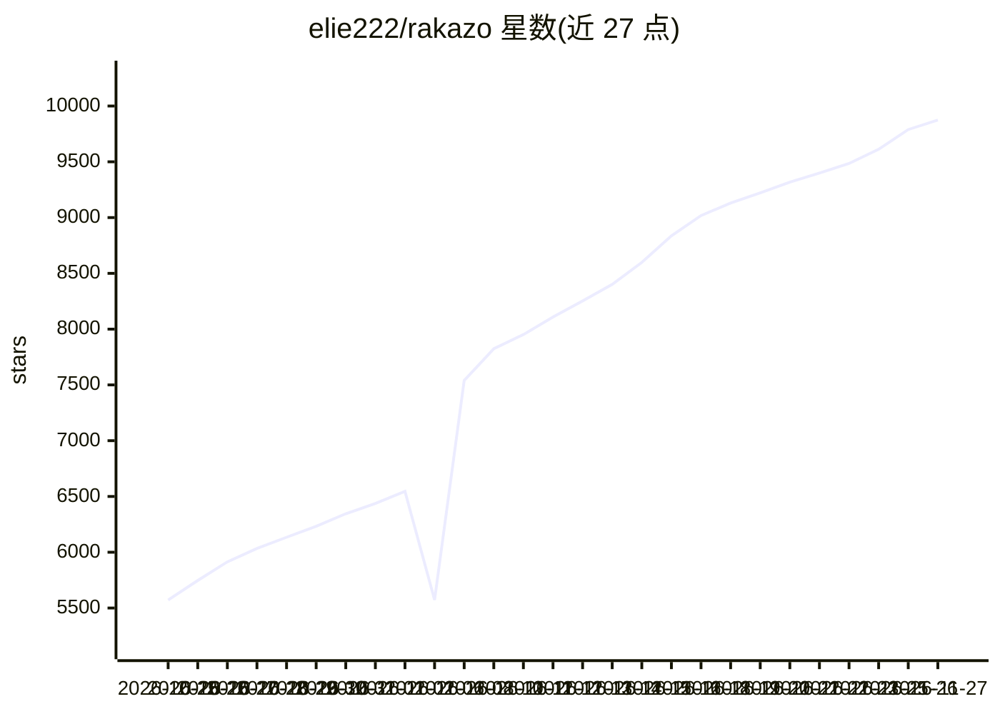

# elie222/rakazo

⭐ 9,875 · TypeScript · Apache-2.0 · 推送 2026-11-26 · [GitHub](https://github.com/elie222/rakazo) · [官网](https://rakazo.com) · 个人维护 · 中文 README

**自托管的 AI 队友平台：每个机器人有记忆、例程与电脑**

开源、自托管的多机器人协作平台，声称是 Grok Bot 等产品的替代选择。每个机器人拥有独立记忆、例程、应用集成与一台可观察/可接管的虚拟电脑（浏览器、终端、桌面）。机器人可在群聊中 @mention 分工协作，支持定时/邮件/webhook 触发例程，生成可分享的仪表盘与文档页面。以 Docker Compose 发布镜像部署，或从源码以 Node.js/pnpm 运行；桌面（Electron）与移动端（Expo）作为同一 API 的客户端，服务器需 VPS 2 vCPU / 4 GB RAM。

## 筛选速览

| 维度 | 判定 | 备注 |
|---|---|---|
| AI 角色 | `ai-native` | 本体是模型或模型工具 |
| 许可风险 | `permissive` | Apache-2.0 |
| 部署形态 | `desktop` | 安装包/桌面程序 |
| 模型依赖 | — | README 未给出锁定关系 |
| 硬件要求 | — | 无带数字的原话,不猜 |
| 安装摩擦 | `low` | 无编译、无系统依赖或容器化 |
| 成熟度 | — | 结构信号不足 |

## 能力要点

- 每个机器人配有浏览器、终端、文件与完整桌面的虚拟电脑
- 群聊 @mention 多机器人分工与互相检查
- 定时、邮件、webhook 触发的例程与运行历史
- 任意模型+自带 API key，数千应用集成与 MCP 支持

## 适用场景

- 在自己的机器上运行带记忆的 AI 队友团队
- 让多个机器人在群聊中协作完成一项任务
- 按日程或 webhook 自动执行例行工作

## 场景标签

`AI 助手` `多智能体` `工作流自动化` · 领域:Agent 开发

## 证据(README 行号)

> L12: Rakazo is an open source, self-hosted alternative to Grok Bot.
> L14: Persistent AI teammates with their own memory, routines, apps, and computer. Run it on your own
> L36: - Any model, with your own keys

## 星数曲线

2026-10-25 5,572 → 2026-11-27 9,875（+4,303）

---
*卡片 v1 · prompt 1.4 · 生成 2026-11-27 · 置信度 high · 依据 README sha `4abdb012bce4` · [字段定义](../../DATASET.md)*
