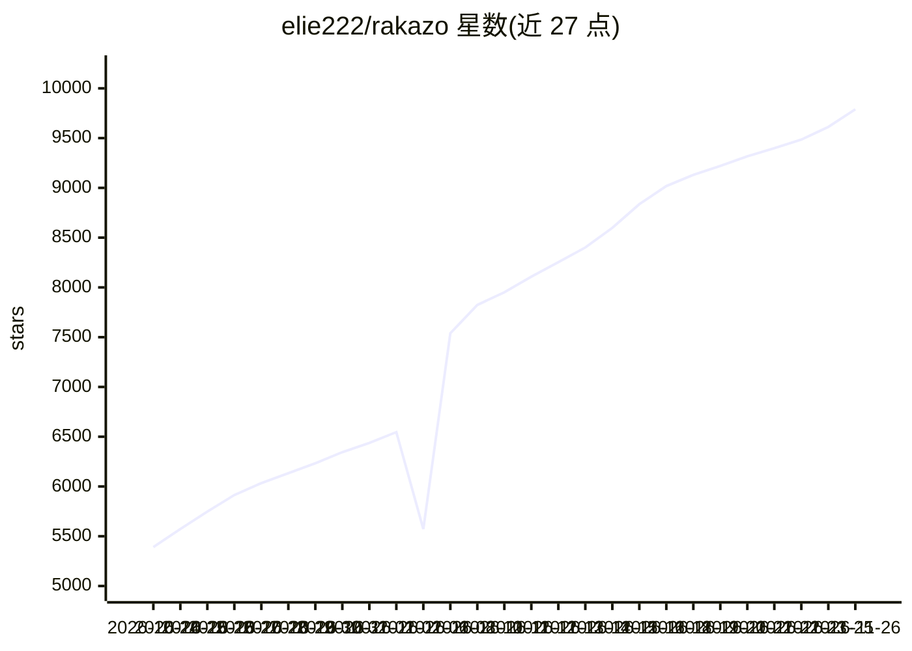

# elie222/rakazo

⭐ 9,789 · TypeScript · Apache-2.0 · 推送 2026-11-25 · [GitHub](https://github.com/elie222/rakazo) · [官网](https://rakazo.com) · 个人维护 · 中文 README

**自托管开源 AI 机器人团队平台：自带模型与沙盒**

Rakazo 是开源、自托管的 Grok Bot 替代品：运行持久化 AI 机器人，每个机器人拥有记忆、定时例程（schedule/email/webhook 触发）、应用集成和一台虚拟计算机（浏览器、终端、文件、桌面）。支持群聊中多个机器人协作分工、委派子代理、语音通话，以及可分享的仪表盘与文档页面。模型由用户以自己的 API key 连接。通过发布镜像的安装脚本部署，或 Node.js/pnpm 源码开发；Web、Electron 桌面、iOS/Android 客户端连接同一服务器。

## 筛选速览

| 维度 | 判定 | 备注 |
|---|---|---|
| AI 角色 | `ai-native` | 本体是模型或模型工具 |
| 许可风险 | `permissive` | Apache-2.0 |
| 部署形态 | `desktop` | 安装包/桌面程序 |
| 模型依赖 | — | README 未给出锁定关系 |
| 硬件要求 | — | 无带数字的原话,不猜 |
| 安装摩擦 | `low` | 无编译、无系统依赖或容器化 |
| 成熟度 | — | 结构信号不足 |

## 能力要点

- 每个机器人配备虚拟计算机：浏览器、终端、文件与完整桌面
- 沙盒支持 Docker 本地、云端或自有机器（e2b/daytona/railway 等可选远程 provider）
- 数千应用集成（Gmail、Slack、GitHub、Notion 等），支持自定义 MCP 服务器与 OpenAPI 工具
- Web、桌面、iPhone、Android 客户端连接同一服务器

## 适用场景

- 在自己机器上运行带记忆与定时任务的 AI 团队助手
- 让多个机器人在群聊中分工协作并互相校验
- 用自有模型 key 搭建接入 Gmail/Slack 等应用的自动化机器人

## 场景标签

`AI 助手` `多智能体` `工作流自动化` · 领域:Agent 开发

## 证据(README 行号)

> L12: Rakazo is an open source, self-hosted alternative to Grok Bot.
> L14: Persistent AI teammates with their own memory, routines, apps, and computer. Run it on your own
> L36: - Any model, with your own keys

## 星数曲线

2026-10-24 5,391 → 2026-11-26 9,789（+4,398）

---
*卡片 v1 · prompt 1.4 · 生成 2026-11-24 · 置信度 mid · 依据 README sha `8c93d4c4e6de` · [字段定义](../../DATASET.md)*
