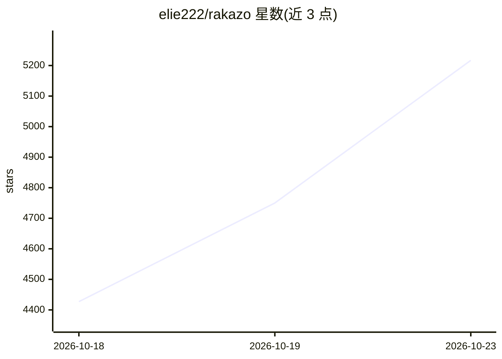

# elie222/rakazo

⭐ 5,217 · TypeScript · Apache-2.0 · 推送 2026-10-22 · [GitHub](https://github.com/elie222/rakazo) · [官网](https://rakazo.com) · 个人维护 · 中文 README

**自托管的持久 AI teammate/助手，可自选模型与沙箱**

开源、可自托管的 AI agent 应用：用户创建具有独立对话、记忆、例程与历史的持久 bot，通过聊天界面管理。支持 web、Electron 桌面端与 iPhone/Android 客户端；自带模型凭证（经 Pi）或本地运行完整栈。沙箱支持 Docker、E2B、Daytona、CreateOS、Box 与本机；bot 可访问浏览器、终端、文件与图形桌面，并可委托 peer bot 或短期子 agent。处于 beta 阶段；安装路径含发布镜像（Docker Compose 安装脚本）与源码运行（Node.js 22/24/26+、pnpm 9、Docker）。

## 筛选速览

| 维度 | 判定 | 备注 |
|---|---|---|
| AI 角色 | `ai-native` | 本体是模型或模型工具 |
| 许可风险 | `permissive` | Apache-2.0 |
| 部署形态 | `self-host` | docker 或自建部署 |
| 模型依赖 | locked-api |  |
| 硬件要求 | — | 无带数字的原话,不猜 |
| 安装摩擦 | `low` | 无编译、无系统依赖或容器化 |
| 成熟度 | `idea` | |

## 能力要点

- 持久 bot：独立对话、记忆、例程与历史
- 沙箱可选 Docker/E2B/Daytona/CreateOS/Box/本机，含浏览器、终端与图形桌面访问
- bot 可委托 peer bot 或短期 subagent
- web、Electron 桌面端、iOS/Android 多端客户端，UI 支持简体中文等多语言

## 适用场景

- 自托管一个可长期对话、有记忆的 AI 助手并从聊天界面管理
- 让 bot 在隔离沙箱中操作浏览器、终端与文件完成任务
- 在服务器上部署后从桌面或手机客户端连接使用

## 场景标签

`AI 助手` `浏览器自动化` · 领域:效率与自动化

## 证据(README 行号)

> L10: Rakazo is an open source AI agent for persistent teammates, and a self-hosted AI assistant you
> L15: It is an open source, self-hosted alternative to Grok Bot, Meta Muse, OpenAI Dots, Instinct,

## 星数曲线

2026-10-18 4,427 → 2026-10-23 5,217（+790）

---
*卡片 v1 · prompt 1.4 · 生成 2026-10-20 · 置信度 high · 依据 README sha `96d0dab70441` · [字段定义](../../DATASET.md)*
