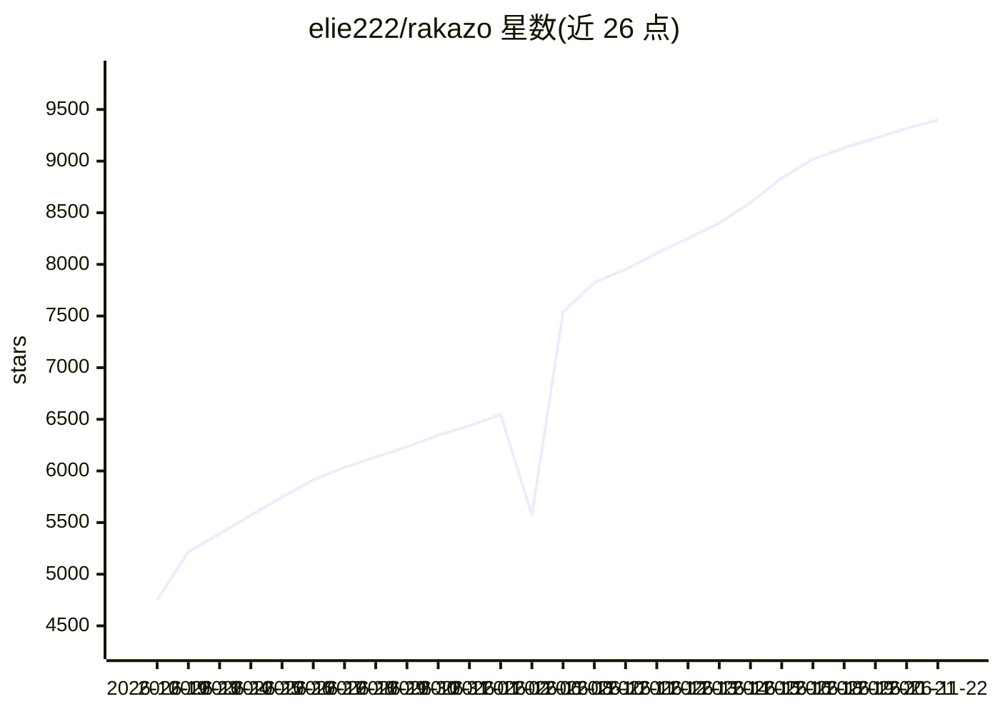

# elie222/rakazo

⭐ 9,399 · TypeScript · Apache-2.0 · 推送 2026-11-21 · [GitHub](https://github.com/elie222/rakazo) · [官网](https://rakazo.com) · 个人维护

**自托管的持久 AI 团队/机器人平台，替代 Grok Bot**

开源可自托管的 AI 机器人平台：每个机器人具备持久记忆、定时例程、可配置的计算机/浏览器沙箱（Docker、云或本机），支持群聊协作、委派与子代理、生成可分享的仪表盘页面、语音通话，以及应用集成与 MCP 工具接入。用户自带模型密钥选择任意模型。通过 Compose 发布镜像快速安装，也支持源码开发；客户端覆盖 Web、Electron 桌面端与 iOS/Android。

## 筛选速览

| 维度 | 判定 | 备注 |
|---|---|---|
| AI 角色 | `ai-ecosystem` | LLM/agent 周边工具 |
| 许可风险 | `permissive` | Apache-2.0 |
| 部署形态 | `desktop` | 安装包/桌面程序 |
| 模型依赖 | — | README 未给出锁定关系 |
| 硬件要求 | — | 无带数字的原话,不猜 |
| 安装摩擦 | `low` | 无编译、无系统依赖或容器化 |
| 成熟度 | — | 结构信号不足 |

## 能力要点

- 每个机器人拥有独立记忆、例程与可观察的计算机沙箱
- 群聊中 @mention 多机器人分工协作并互相检查
- 支持 Docker/e2b/daytona/railway 等多种沙箱提供方
- 数千应用集成，支持自有 MCP 服务器与 OpenAPI 工具

## 适用场景

- 在自己服务器上运行一支可长期驻留的 AI 团队
- 用定时/邮件/webhook 触发机器人自动执行例程
- 让多机器人协作完成并交叉校验任务

## 场景标签

`聊天机器人` `多智能体` `Agent 记忆` · 领域:Agent 开发

## 证据(README 行号)

> L12: Rakazo is an open source, self-hosted alternative to Grok Bot.
> L14: Persistent AI teammates with their own memory, routines, apps, and computer. Run it on your own
> L36: - Any model, with your own keys

## 星数曲线

2026-10-19 4,750 → 2026-11-22 9,399（+4,649）

---
*卡片 v1 · prompt 1.4 · 生成 2026-11-22 · 置信度 mid · 依据 README sha `729cc81e7dbd` · [字段定义](../../DATASET.md)*
