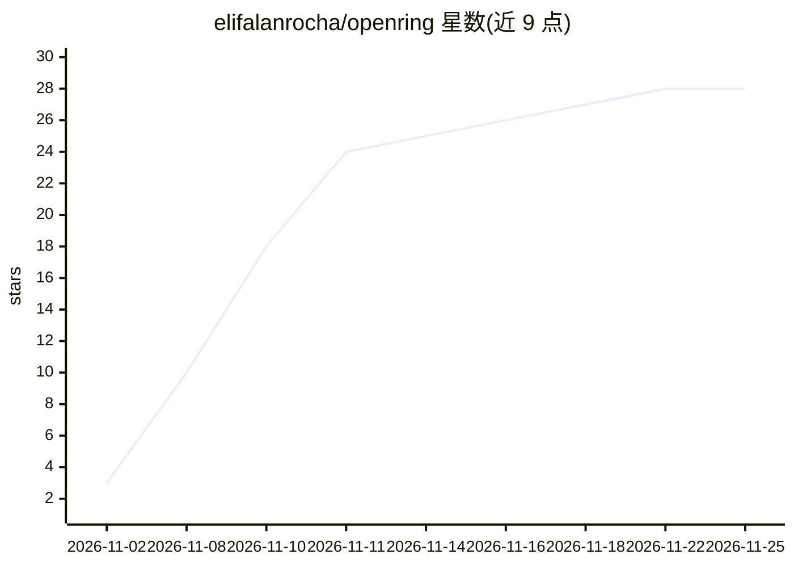

# elifalanrocha/openring

⭐ 28 · Python · MIT · 推送 2026-11-22 · [GitHub](https://github.com/elifalanrocha/openring) · [官网](https://realvalorai.com.br/openring) · 个人维护

**自托管的 Vapi 兼容语音 AI 电话代理服务器，无平台费**

在自有服务器上运行 AI 电话代理、语音代理与 AI 前台的开源服务器：通过 Twilio、Telnyx、Plivo、Vonage 或 SIP 中继接打电话，API 兼容 Vapi 的 JSON 格式，可用自有 provider 密钥或 100% 本地免费栈（Whisper、Ollama、Kokoro）。每次通话经 Pipecat 管道处理：语音转文本、模型应答（可调用工具）、语音合成回播，逐轮延迟与各 provider 成本记录在仪表盘中。以 npx 一条命令启动，需 Node.js 18+，也提供 Docker 与镜像部署。限制：除 Twilio 外的电话运营商尚未经真实通话验证；WhatsApp 通话为非官方方案。

## 筛选速览

| 维度 | 判定 | 备注 |
|---|---|---|
| AI 角色 | `ai-ecosystem` | LLM/agent 周边工具 |
| 许可风险 | `permissive` | MIT |
| 部署形态 | `self-host` | docker 或自建部署 |
| 模型依赖 | local-ok | 支持本地模型 |
| 硬件要求 | — | 无带数字的原话,不猜 |
| 安装摩擦 | `low` | 无编译、无系统依赖或容器化 |
| 成熟度 | — | 结构信号不足 |

## 能力要点

- Vapi 兼容 API：改 base URL 即迁移，一键导入 Vapi 账户
- 100% 本地免费栈：Whisper 转写 + Ollama 模型 + Kokoro 语音，音频不出本机
- 支持 12+ 云模型 provider、6+ 转写 provider、9+ 语音 provider 及本地选项
- 通话成本、延迟、逐轮记录与模型路由（最快/最便宜/可靠预设）仪表盘

## 适用场景

- 自建 AI 电话前台/客服，避免托管平台的每分钟费用
- 从 Vapi 迁移现有助手、工具与电话号码到自有服务器
- 用本地免费栈零成本测试语音 AI 代理

## 场景标签

`语音 Agent` · 领域:对话与助手

## 证据(README 行号)

> L66: Each call runs a Pipecat pipeline: the caller's speech becomes
> L119: Every request takes `Authorization: Bearer $OPENRING_API_KEY`, and the JSON is Vapi's. The full guide is in

## 星数曲线

2026-11-02 3 → 2026-11-25 28（+25）

---
*卡片 v1 · prompt 1.4 · 生成 2026-11-18 · 置信度 high · 依据 README sha `b11c526bff15` · [字段定义](../../DATASET.md)*
