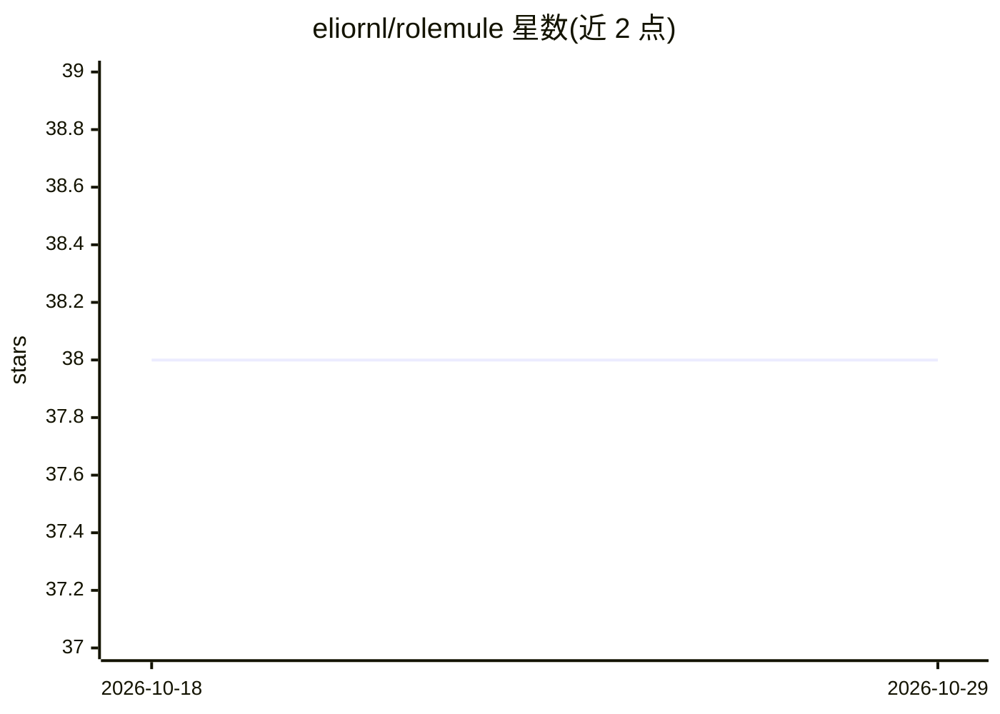

# eliornl/rolemule

⭐ 38 · Python · MIT · 推送 2026-10-28 · [GitHub](https://github.com/eliornl/rolemule) · [官网](https://eliornl.github.io/rolemule) · 个人维护

**求职者的自托管 AI 求职助手：五 Agent 分析职位并生成申请材料**

基于 FastAPI + LangGraph + PostgreSQL/Redis 的自托管 Web 应用，面向求职者。粘贴职位描述（或经 Chrome 扩展抓取）后五个 Agent 依次产出职位分析、匹配评分、公司调研、简历建议与求职信，另有 CV 优化、模拟面试、薪资谈判等九个按需 Agent 和六个独立职业工具。BYOK 模式：用户在设置中选择 Gemini/OpenAI/Anthropic 或本地 Ollama，自备 API key（Ollama 无需 key）。提供 Docker、macOS 一键脚本、手动三种部署方式及配套 CLI。

## 筛选速览

| 维度 | 判定 | 备注 |
|---|---|---|
| AI 角色 | `ai-native` | 本体是模型或模型工具 |
| 许可风险 | `permissive` | MIT |
| 部署形态 | `desktop` | 安装包/桌面程序 |
| 模型依赖 | local-ok | 支持本地模型 |
| 硬件要求 | — | 无带数字的原话,不猜 |
| 安装摩擦 | `low` | 无编译、无系统依赖或容器化 |
| 成熟度 | — | 结构信号不足 |

## 能力要点

- 五 Agent 编排流水线，约 30 秒内产出职位分析到求职信
- BYOK 支持 Gemini/OpenAI/Anthropic/本地 Ollama，本地推理无需 key
- 附加九个按需 Agent（CV 优化迭代打分、限时模拟面试等）与六个独立职业工具
- 提供 Chrome 扩展一键抓取任意求职网站职位、终端 CLI 与应用追踪仪表盘

## 适用场景

- 投递前快速获得职位匹配评分、公司调研与针对性求职信
- 用本地 Ollama 跑全套求职分析流程而不外发数据
- 通过 CLI 和个人访问令牌把求职分析接入脚本或 AI 编码助手
- 用限时对话式模拟面试和结构化复盘做面试准备

## 场景标签

`AI 写作` `聊天机器人` · 领域:对话与助手

## 证据(README 行号)

> L30: Paste a job description, upload a PDF / TXT / DOCX, or pull the posting from any job site with the Chrome extension
> L32: Also includes a dashboard to track every application. And tools for everything around it: interview prep, timed moc

## 星数曲线

2026-10-18 38 → 2026-10-29 38（+0）

---
*卡片 v1 · prompt 1.4 · 生成 2026-10-25 · 置信度 high · 依据 README sha `eea5f8cae29b` · [字段定义](../../DATASET.md)*
