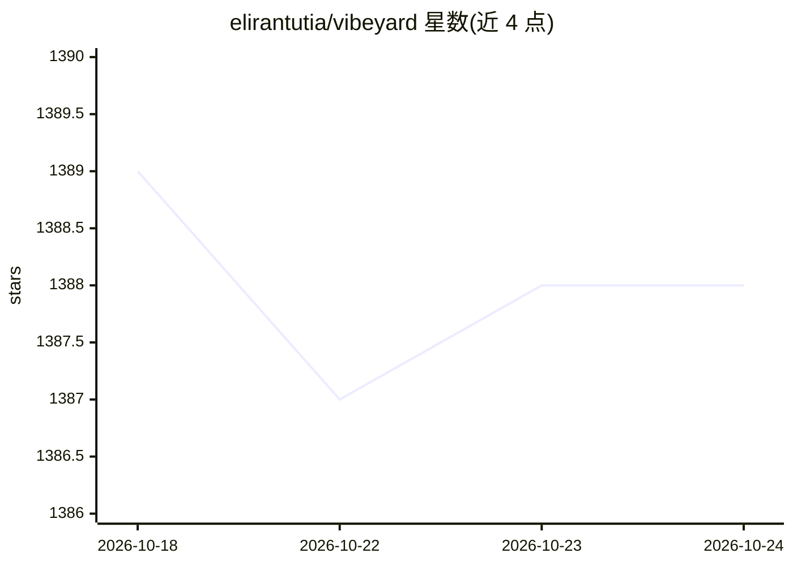

# elirantutia/vibeyard

⭐ 1,388 · TypeScript · MIT · 推送 2026-09-03 · [GitHub](https://github.com/elirantutia/vibeyard) · 个人维护

**面向 AI 编码代理的桌面 IDE：并行管理多 agent 会话**

基于 Electron 的桌面工作区，用于运行和管理 Claude Code、OpenAI Codex CLI、Gemini CLI 等 AI 编码代理：支持多会话并行（各自独立 PTY）、swarm 网格视图、看板任务板与一键生成/恢复会话、按会话的成本与上下文窗口监控、多个 Claude 配置文件隔离凭据、会话恢复、WebRTC 点对点只读/读写会话共享，以及嵌入式浏览器标签页向 AI 发送带选择器的编辑指令。需预装至少一个受支持的 CLI 并完成认证；提供 macOS/Linux/Windows 安装包、npm 全局安装与源码构建（Node v24+）三种方式。

## 筛选速览

| 维度 | 判定 | 备注 |
|---|---|---|
| AI 角色 | `ai-ecosystem` | LLM/agent 周边工具 |
| 许可风险 | `permissive` | MIT |
| 部署形态 | `desktop` | 安装包/桌面程序 |
| 模型依赖 | locked-api |  |
| 硬件要求 | — | 无带数字的原话,不猜 |
| 安装摩擦 | `low` | 无编译、无系统依赖或容器化 |
| 成熟度 | — | 结构信号不足 |

## 能力要点

- 多会话管理：每项目多 agent 会话，各自独立 PTY，swarm 网格视图
- 看板任务板：卡片一键生成/恢复 CLI 会话，完成自动移入 Done
- 按会话实时追踪成本、token 用量与上下文窗口，会话检查器查看遥测
- 多个 Claude 配置文件隔离凭据与历史；会话重启后可恢复

## 适用场景

- 同时跑多个 AI 编码代理会话并看板化管理任务
- 追踪每个 agent 会话的花费与上下文占用
- 团队间通过加密 P2P 共享实时终端会话

## 场景标签

`编码 Agent` · 领域:编码与开发

## 证据(README 行号)

> L13:  Manage multiple agent sessions, run them in parallel, track costs, and never lose context — with Claude Code, Code
> L42: > Supports Claude Code, OpenAI Codex CLI, and Gemini CLI. More AI CLI providers coming soon.

## 星数曲线

2026-10-18 1,389 → 2026-10-24 1,388（-1）

---
*卡片 v1 · prompt 1.4 · 生成 2026-10-21 · 置信度 high · 依据 README sha `02bc4b39ddb5` · [字段定义](../../DATASET.md)*
