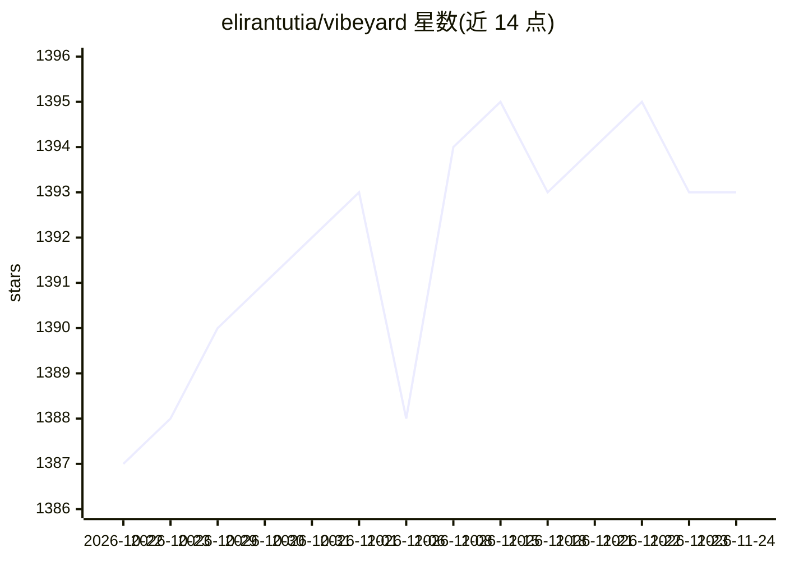

# elirantutia/vibeyard

⭐ 1,393 · TypeScript · MIT · 推送 2026-11-21 · [GitHub](https://github.com/elirantutia/vibeyard) · 个人维护

**给 AI 编码 agent 用的多会话管理 IDE**

基于 Electron 的桌面 IDE，用于管理 Claude Code、OpenAI Codex CLI、Gemini CLI 等编码 agent 的运行：按项目组织多会话（每会话独立 PTY）、看板任务板一键启动/恢复会话、实时成本与 token 用量及上下文窗口跟踪、会话遥测检查器、swarm 网格视图。其他机制包括多 Claude 配置文件隔离登录、WebRTC P2P 会话共享（只读/读写+PIN）、agent 通过 vibeyard-ctl 命令通道操作标签页、嵌入式浏览器发送元素级 AI 编辑指令。macOS/Linux/Windows 提供安装包，也可经 npm 或源码运行，需先装好至少一个受支持的 CLI 并完成认证。

## 筛选速览

| 维度 | 判定 | 备注 |
|---|---|---|
| AI 角色 | `ai-ecosystem` | LLM/agent 周边工具 |
| 许可风险 | `permissive` | MIT |
| 部署形态 | `desktop` | 安装包/桌面程序 |
| 模型依赖 | — | README 未给出锁定关系 |
| 硬件要求 | — | 无带数字的原话,不猜 |
| 安装摩擦 | `low` | 无编译、无系统依赖或容器化 |
| 成熟度 | — | 结构信号不足 |

## 能力要点

- 多 agent CLI 会话管理，每会话独立 PTY，支持 swarm 网格视图
- 成本、token 用量与上下文窗口实时跟踪与会话遥测
- 多 Claude 配置文件隔离（独立 config 目录）
- vibeyard-ctl 命令通道让 agent 可编程控制标签页

## 适用场景

- 同时并行运行多个 Claude Code/Codex/Gemini 会话并统一管理
- 按项目跟踪各 agent 会话的成本与上下文用量
- 团队间通过 P2P 共享实时终端会话
- 用看板组织任务并由会话自动推进状态

## 场景标签

`编码 Agent` · 领域:编码与开发

## 证据(README 行号)

> L12:  The IDE built for AI coding agents.
> L13:  Manage multiple agent sessions, run them in parallel, track costs, and never lose context — with Claude Code, Code
> L42: > Supports Claude Code, OpenAI Codex CLI, and Gemini CLI. More AI CLI providers coming soon.

## 星数曲线

2026-10-22 1,387 → 2026-11-24 1,393（+6）

---
*卡片 v1 · prompt 1.4 · 生成 2026-11-23 · 置信度 high · 依据 README sha `47a4ebefe609` · [字段定义](../../DATASET.md)*
