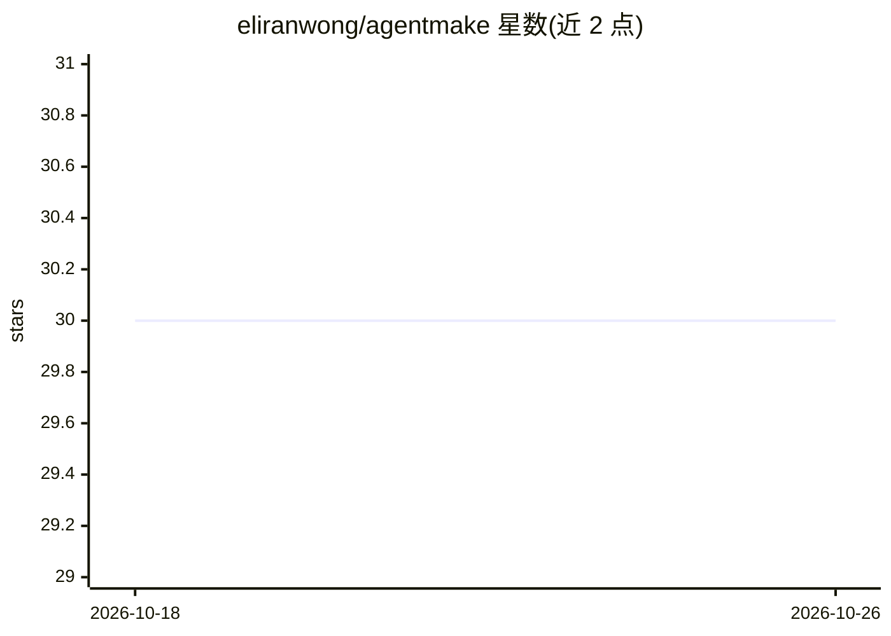

# eliranwong/agentmake

⭐ 30 · Python · MIT · 推送 2026-07-07 · [GitHub](https://github.com/eliranwong/agentmake) · [官网](https://toolmate.ai) · 个人维护

**Agent 应用开发套件：统一接口接入 20+ AI 后端与 7 类组件**

Python 库形式的 agent 开发套件（ADK），提供单一签名函数 agentmake 统一调用 20 余种 AI 后端（Anthropic/OpenAI/DeepSeek/Groq/Ollama/Llama.cpp 等），默认使用 Ollama 并可自动下载模型。通过 system、instruction、输入输出插件、tool、agent、follow_up_prompt 七类组件构建 agent 应用，内置组件可直接按文件名引用，也支持自定义组件覆盖。配套 Web UI（agentmakestudio）与 MCP 服务器扩展。跨 Windows/macOS/Linux/ChromeOS/Android Termux 平台。

## 筛选速览

| 维度 | 判定 | 备注 |
|---|---|---|
| AI 角色 | `ai-ecosystem` | LLM/agent 周边工具 |
| 许可风险 | `permissive` | MIT |
| 部署形态 | `library` | 以包/库形式分发 |
| 模型依赖 | local-ok | 支持本地模型 |
| 硬件要求 | — | 无带数字的原话,不猜 |
| 安装摩擦 | `low` | 无编译、无系统依赖或容器化 |
| 成熟度 | — | 结构信号不足 |

## 能力要点

- 单一 agentmake 函数统一访问 20+ AI 后端，默认 Ollama 且自动下载缺失模型
- 7 类 agent 组件体系（system/instruction/插件/tool/agent/follow_up_prompt）
- 自定义组件同名可覆盖内置组件
- 可选安装 Web UI（Studio）、MCP 服务器与 Vertex AI 扩展

## 适用场景

- 开发者构建多后端可切换的 agent 应用
- 组合工具、插件与多 agent 工作流自动化复杂任务
- 在本地 Ollama/Llama.cpp 后端上运行 agent 工作流

## 场景标签

`Agent 框架` `多智能体` `模型网关` · 领域:Agent 开发

## 证据(README 行号)

> L3: AgentMake AI: an agent developement kit (ADK) for developing agentic AI applications that support 18 AI backends and
> L95: `agentmake` is designed to work with seven kinds of components for building agentic applications:
> L209: This SDK is designed to offer a single signature function `agentmake` for interacting with all AI backends, delive

## 星数曲线

2026-10-18 30 → 2026-10-26 30（+0）

---
*卡片 v1 · prompt 1.4 · 生成 2026-10-26 · 置信度 high · 依据 README sha `a47d35b8cf1c` · [字段定义](../../DATASET.md)*
