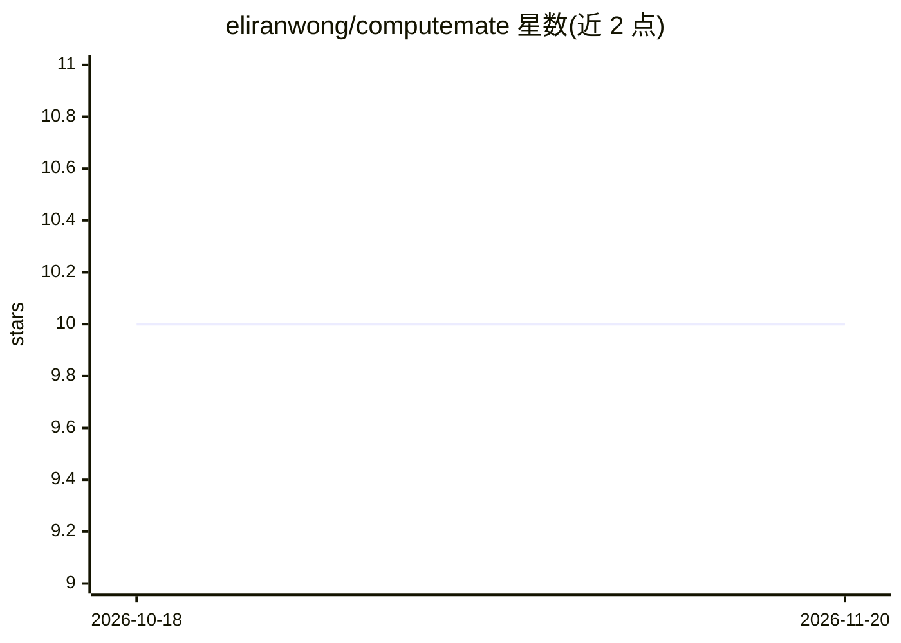

# eliranwong/computemate

⭐ 10 · Python · 推送 2026-01-15 · [GitHub](https://github.com/eliranwong/computemate) · 个人维护

**自动化 AI Agent CLI：规划、编排多工具并执行用户任务**

基于 AgentMake AI 框架的终端 Agent 应用：接收用户目标后生成 Master Prompt，经 supervisor agent 审阅、工具选择 agent 选工具、指令生成 agent 转写，再由 AI 助手调用内置工具或用户配置的 MCP 服务器执行，最后汇总结果。提供聊天、Agent、Partner 三种模式，支持 16 种 AI 后端切换、会话保存/导入导出、内置文本编辑器与大量快捷键。通过 pip 安装，Vertex AI 需额外 extra 依赖。

## 筛选速览

| 维度 | 判定 | 备注 |
|---|---|---|
| AI 角色 | `ai-native` | 本体是模型或模型工具 |
| 许可风险 | `permissive` | — |
| 部署形态 | `library` | 以包/库形式分发 |
| 模型依赖 | — | README 未给出锁定关系 |
| 硬件要求 | — | 无带数字的原话,不猜 |
| 安装摩擦 | `low` | 无编译、无系统依赖或容器化 |
| 成熟度 | — | 结构信号不足 |

## 能力要点

- 多 agent 协作工作流：supervisor、工具选择、指令生成与执行 agent 分工
- 支持 16 种 AI 后端，可通过 .backend 或 -b 参数切换
- 支持接入内置 AgentMake 工具与第三方 MCP 服务器
- 三种 AI 模式（Chat/Agent/Partner）与可覆盖的系统提示词定制

## 适用场景

- 把一个多步骤目标交给 Agent 自动规划并调用工具执行
- 通过 Partner 模式人工审核每个执行步骤
- 通过 MCP 服务器扩展 Agent 可用的外部工具

## 场景标签

`多智能体` `AI 助手` `工作流自动化` · 领域:Agent 开发

## 证据(README 行号)

> L3: computemate.ai is an automation-first AI agent that takes your goals, creates a structured plan, and executes it by 
> L108: * **Agent mode** – A fully autonomous agent designed to plan, orchestrate tools, and take multiple actions to addr
> L22: * **Versatile** – supports 16 AI backends and numerous models, leveraging the advantages of AgentMake AI.

## 星数曲线

2026-10-18 10 → 2026-11-20 10（+0）

---
*卡片 v1 · prompt 1.4 · 生成 2026-11-19 · 置信度 high · 依据 README sha `ca5c8fa947bd` · [字段定义](../../DATASET.md)*
