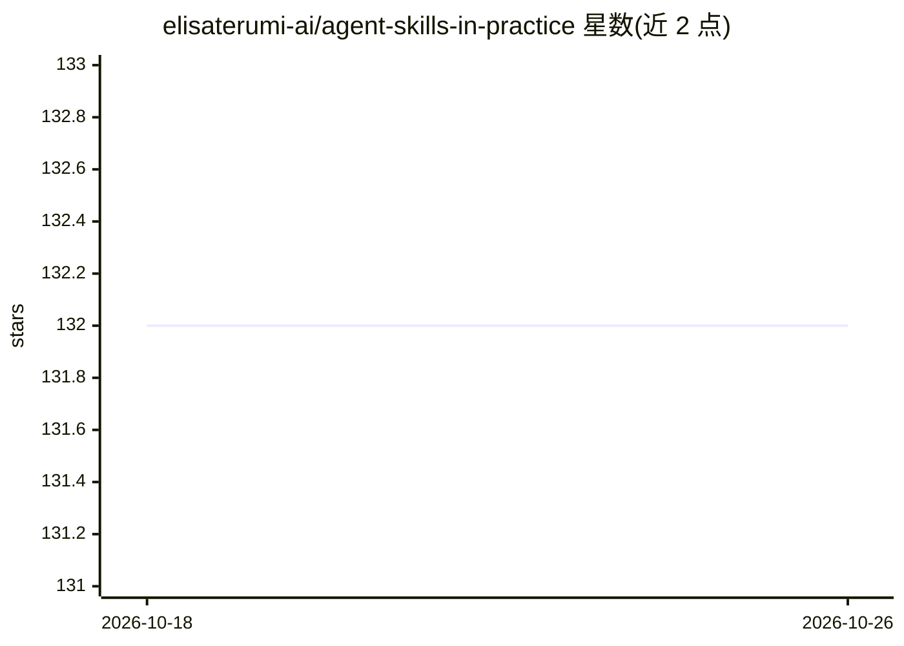

# elisaterumi-ai/agent-skills-in-practice

⭐ 132 · Apache-2.0 · 推送 2026-05-16 · [GitHub](https://github.com/elisaterumi-ai/agent-skills-in-practice) · 个人维护

**AI 技能（Skills）设计与应用的实践指南**

由个人维护的教程型仓库，讲解 Claude Code 中 AI 技能的概念、结构与使用：技能以含 SKILL.md 的目录形式存在，通过名称与描述的语义匹配按需加载，可作用于个人级（~/.claude/skills）或项目级（.claude/skills）。内容涵盖技能与 CLAUDE.md、Slash Commands 的区别、创建步骤、元数据字段、渐进式披露等进阶概念，并提供模板、示例与资源链接。仓库本身不含可运行代码，主要以文档形式提供。

## 筛选速览

| 维度 | 判定 | 备注 |
|---|---|---|
| AI 角色 | `ai-knowledge` | 知识聚合/清单类 |
| 许可风险 | `permissive` | Apache-2.0 |
| 部署形态 | `None` |  |
| 模型依赖 | — | README 未给出锁定关系 |
| 硬件要求 | — | 无带数字的原话,不猜 |
| 安装摩擦 | `low` | 无编译、无系统依赖或容器化 |
| 成熟度 | — | 结构信号不足 |

## 能力要点

- 讲解 SKILL.md 目录结构与语义匹配按需加载机制
- 对比 Skills 与 CLAUDE.md、Slash Commands 的差异
- 提供技能创建三步教程与元数据字段说明
- 覆盖渐进式披露（references/scripts/assets）等进阶概念

## 适用场景

- 学习如何为 Claude Code 编写可复用技能
- 团队沉淀统一的工作流与输出规范
- 了解技能的加载机制与常见设计错误

## 场景标签

`教程课程` · 领域:学习与行业

## 证据(README 行号)

> L4: # AI Skills — A Practical Guide
> L22: A **skill** is a structured set of instructions that teaches an AI system how to perform a specific task.

## 星数曲线

2026-10-18 132 → 2026-10-26 132（+0）

---
*卡片 v1 · prompt 1.4 · 生成 2026-10-22 · 置信度 high · 依据 README sha `0acc77e1c891` · [字段定义](../../DATASET.md)*
