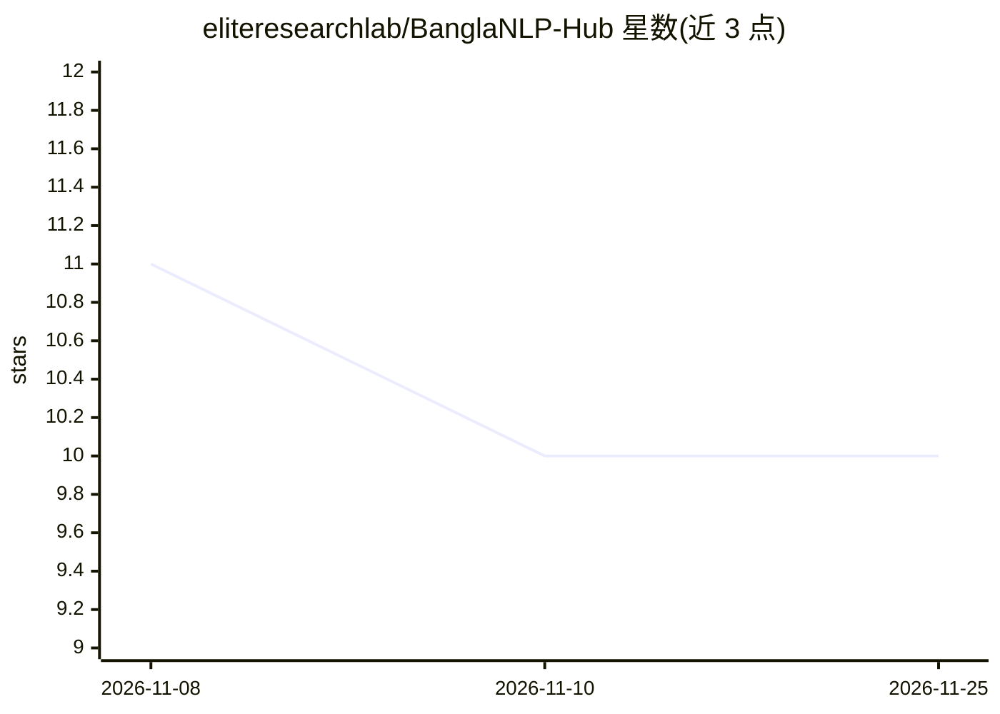

# eliteresearchlab/BanglaNLP-Hub

⭐ 10 · Astro · MIT · 推送 2026-11-23 · [GitHub](https://github.com/eliteresearchlab/BanglaNLP-Hub) · [官网](https://eliteresearchlab.github.io/BanglaNLP-Hub/) · 组织维护

**面向孟加拉语 NLP 研究者的论文/数据集/模型/工具目录**

社区维护的孟加拉语（Bangla/Bengali）NLP 资源目录网站，收录论文、数据集、模型、工具与基准，按任务浏览并可搜索，每条目链接原始来源。数据管理强调可溯源：不编造分数、引用数与 BibTeX，排行榜仅在给出处后填充，链接每晚自动核验，条目对照 ACL Anthology/arXiv/OpenAlex 人工审核。基于 Astro 与 TypeScript 构建，需 Node.js 22.23.4+，以 npm 命令运行开发/构建与数据校验。

## 筛选速览

| 维度 | 判定 | 备注 |
|---|---|---|
| AI 角色 | `ai-knowledge` | 知识聚合/清单类 |
| 许可风险 | `permissive` | MIT |
| 部署形态 | `library` | 以包/库形式分发 |
| 模型依赖 | — | README 未给出锁定关系 |
| 硬件要求 | — | 无带数字的原话,不猜 |
| 安装摩擦 | `low` | 无编译、无系统依赖或容器化 |
| 成熟度 | — | 结构信号不足 |

## 能力要点

- 按任务组织的孟加拉语 NLP 资源目录，条目均链接原始来源
- 可分享的过滤 URL（任务/许可/年份/venue 等参数）
- 每晚自动核验已发布链接，人工审核条目元数据
- npm run validate / check-links 提供数据与链接校验

## 适用场景

- 查找孟加拉语情感分析等任务的公开数据集
- 为低资源语言研究搜集相关论文与基准
- 核验孟加拉语资源的许可证与出处信息

## 场景标签

`精选清单` · 领域:学习与行业

## 证据(README 行号)

> L3: A community-maintained catalog of Bangla / Bengali NLP papers, datasets, models,
> L10: BanglaNLP Hub helps researchers, students, and developers find resources for working

## 星数曲线

2026-11-08 11 → 2026-11-25 10（-1）

---
*卡片 v1 · prompt 1.4 · 生成 2026-11-19 · 置信度 high · 依据 README sha `dc66b03eab53` · [字段定义](../../DATASET.md)*
