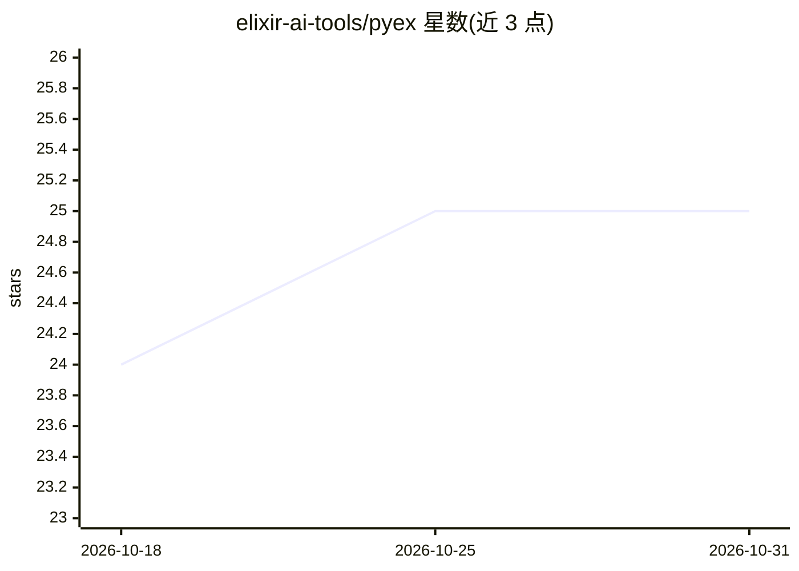

# elixir-ai-tools/pyex

⭐ 25 · Elixir · MIT · 推送 2026-07-07 · [GitHub](https://github.com/elixir-ai-tools/pyex) · [官网](https://pyex.dev) · 组织维护

**给 agent 开发者的 Elixir 版 Python 解释器：沙箱化执行 LLM 生成的代码**

用 Elixir 实现的树遍历式 Python 3 解释器，作为 agent 循环的执行底座：LLM 生成的 Python（含控制器、重试、评测代码）不进入 CPython 运行时，而是作为 BEAM 上的纯函数调用执行。文件、网络、数据库等能力均以值的形式由宿主显式传入，默认拒绝；无子进程、无原生代码加载、网络按前缀白名单。实现了代理常用 Python 子集（非 CPython 替代，纯 CPU 约 10-100 倍慢），提供步数/内存/超时等资源上限与 CI 静态分析保证逃逸边界，并声明未经第三方安全审计。面向在 BEAM 上构建 agent 的开发者。

## 筛选速览

| 维度 | 判定 | 备注 |
|---|---|---|
| AI 角色 | `ai-ecosystem` | LLM/agent 周边工具 |
| 许可风险 | `permissive` | MIT |
| 部署形态 | `None` |  |
| 模型依赖 | — | README 未给出锁定关系 |
| 硬件要求 | — | 无带数字的原话,不猜 |
| 安装摩擦 | `low` | 无编译、无系统依赖或容器化 |
| 成熟度 | `idea` | |

## 能力要点

- 能力即值：文件/网络/SQL/S3 等能力由宿主显式传入，默认拒绝
- 静态分析器在 CI 中检查编译产物不得引用 File/Port/Process 等宿主原语
- 步数、内存、输出字节、调用深度与计算超时在每步边界检查，错误结构化返回
- 可选后端：explorer(Polars) 支持 pandas、postgrex 支持 sql、cmark 支持 markdown

## 适用场景

- 在 Elixir/BEAM 应用中执行 LLM 生成的 Python 代码而不启动 Python 运行时
- 用 Python 编写 agent 控制器循环，工具调用分发到注册的 Elixir 函数
- 对不可信代码施加内存与墙钟硬上限后再执行

## 场景标签

`Agent 框架` · 领域:Agent 开发

## 证据(README 行号)

> L3: A Python 3 interpreter written in Elixir, designed as an execution
> L18: Pyex exists for one shape of problem: running Python written by, or

## 星数曲线

2026-10-18 24 → 2026-10-31 25（+1）

---
*卡片 v1 · prompt 1.4 · 生成 2026-10-27 · 置信度 high · 依据 README sha `b422980bbd79` · [字段定义](../../DATASET.md)*
