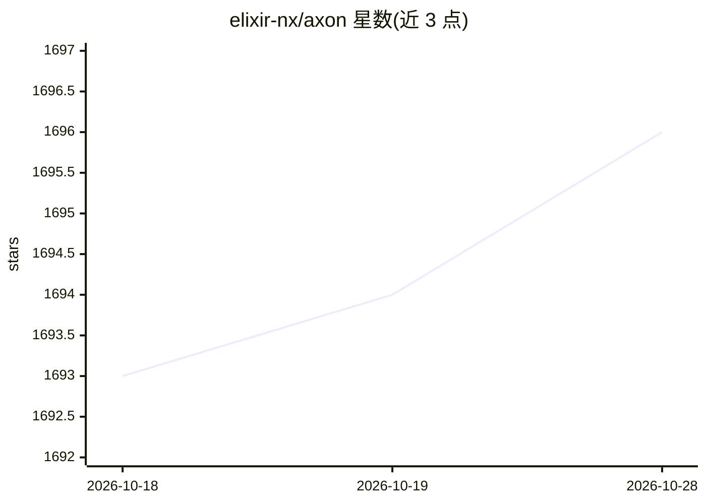

# elixir-nx/axon

⭐ 1,696 · Elixir · Apache-2.0 · 推送 2026-10-08 · [GitHub](https://github.com/elixir-nx/axon) · 组织维护

**Elixir 语言神经网络库：基于 Nx 构建与训练深度学习模型**

面向 Elixir 开发者的神经网络库，构建于 Nx 之上，提供三层 API：底层函数式 API（激活、初始化、层、损失、指标的 defn 实现）、高层模型创建 API（模型即 Elixir 结构，可初始化与预测）以及受 PyTorch Ignite 启发的训练 API（Axon.Loop）。优化由 Polaris 提供且不依赖 Axon 模型本身。所有方法基于 Nx 张量，可用任意 Nx 编译器/后端 JIT 或 AOT 编译，并可导出为 ONNX、TensorFlow Lite 格式。通过 mix 依赖安装，实际负载建议搭配 EXLA 等 Nx 编译器。分布式训练循环为计划中功能。

## 筛选速览

| 维度 | 判定 | 备注 |
|---|---|---|
| AI 角色 | `ai-native` | 本体是模型或模型工具 |
| 许可风险 | `permissive` | Apache-2.0 |
| 部署形态 | `None` |  |
| 模型依赖 | — | README 未给出锁定关系 |
| 硬件要求 | — | 无带数字的原话,不猜 |
| 安装摩擦 | `low` | 无编译、无系统依赖或容器化 |
| 成熟度 | — | 结构信号不足 |

## 能力要点

- 函数式/模型创建/训练三层解耦 API
- 全部实现为 defn，可由任意 Nx 编译器或后端加速
- 支持导出 ONNX 与 TensorFlow Lite 格式
- 训练 API 受 PyTorch Ignite 启发，可挂载指标与事件处理器

## 适用场景

- 在 Elixir 项目中定义与训练神经网络
- 将 Axon 模型编译为 ONNX/TFLite 以便部署
- 优化任意可微分目标函数（经 Polaris）

## 场景标签

`模型训练` · 领域:训练与推理

## 证据(README 行号)

> L5: Nx-powered Neural Networks for Elixir.
> L21: At the lowest-level, Axon consists of a number of modules with functional implementations of common methods in deep

## 星数曲线

2026-10-18 1,693 → 2026-10-28 1,696（+3）

---
*卡片 v1 · prompt 1.4 · 生成 2026-10-21 · 置信度 high · 依据 README sha `b92e5a6336f9` · [字段定义](../../DATASET.md)*
