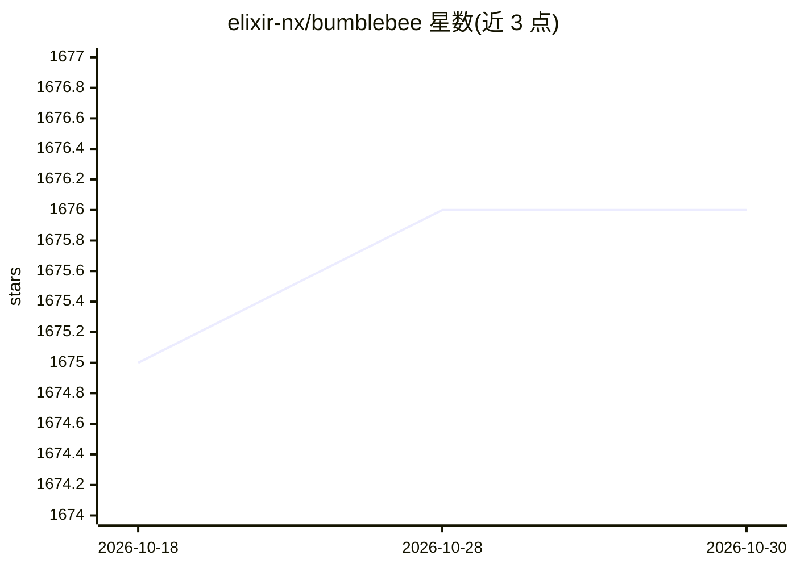

# elixir-nx/bumblebee

⭐ 1,676 · Elixir · Apache-2.0 · 推送 2026-10-26 · [GitHub](https://github.com/elixir-nx/bumblebee) · 组织维护

**Elixir 预训练神经网络库：加载 Hugging Face 模型执行 ML 任务**

基于 Axon 的 Elixir 库，集成 Hugging Face Models，可下载预训练模型并通过少量代码执行机器学习任务。提供 load_model/load_tokenizer 接口与 serving 式端到端 pipeline；需模型架构在 Bumblebee 中有实现方可加载，tokenizer 仅支持 Rust 实现的 fast tokenizer（tokenizer.json）。搭配 EXLA 可在 CPU/GPU 上即时编译运行（需设置 XLA_TARGET），另有 Livebook Smart Cells 与 Phoenix 示例。

## 筛选速览

| 维度 | 判定 | 备注 |
|---|---|---|
| AI 角色 | `ai-native` | 本体是模型或模型工具 |
| 许可风险 | `permissive` | Apache-2.0 |
| 部署形态 | `None` |  |
| 模型依赖 | — | README 未给出锁定关系 |
| 硬件要求 | — | 无带数字的原话,不猜 |
| 安装摩擦 | `low` | 无编译、无系统依赖或容器化 |
| 成熟度 | — | 结构信号不足 |

## 能力要点

- 从 Hugging Face Hub 下载 Transformers 格式模型参数并构建对应 Axon 模型
- serving 形式的端到端任务 pipeline 高层 API
- 支持 PyTorch (.bin) 与 Safetensors 参数格式，不支持 Flax/TensorFlow 格式
- tokenizer 依赖 Rust Tokenizers 绑定，仅支持 fast tokenizer 文件

## 适用场景

- 在 Elixir/Phoenix 应用中直接运行 BERT 等预训练模型
- 通过 Livebook Smart Cells 快速尝试神经网络任务
- 将 Hugging Face 上的模型导入 Elixir 生态部署

## 场景标签

`推理引擎` · 领域:训练与推理

## 证据(README 行号)

> L6: Bumblebee provides pre-trained Neural Network models on top of Axon. It includes integration with 🤗 Models, allowing
> L69: Model repositories are regular Git repositories, therefore they can store arbitrary files. However, most repositori

## 星数曲线

2026-10-18 1,675 → 2026-10-30 1,676（+1）

---
*卡片 v1 · prompt 1.4 · 生成 2026-10-21 · 置信度 high · 依据 README sha `c5931a693171` · [字段定义](../../DATASET.md)*
