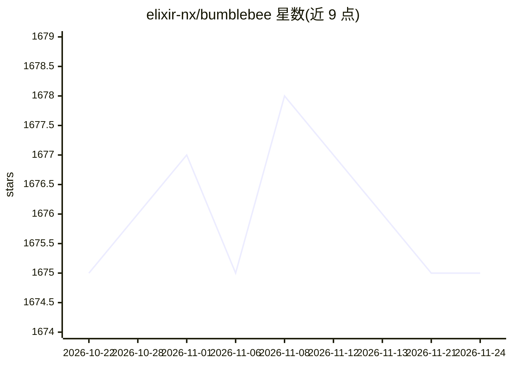

# elixir-nx/bumblebee

⭐ 1,675 · Elixir · Apache-2.0 · 推送 2026-11-17 · [GitHub](https://github.com/elixir-nx/bumblebee) · 组织维护

**Elixir 预训练模型库：数行代码加载并运行 HF 模型任务**

构建在 Axon 之上的 Elixir 预训练神经网络模型库，集成 Hugging Face Hub，可加载 Transformers 格式模型并按需导入参数；通过 Nx/EXLA 后端在 CPU/GPU 上即时编译运行，并以 serving 管道形式提供端到端任务执行。要求模型类型在库内有实现方可加载，tokenizer 依赖 tokenizer.json 文件（缺省时可从原模型仓库查找或转换生成）。通过 mix.exs 依赖或 Mix.install 安装，另提供 Phoenix 应用单文件示例与 Livebook Smart Cells 入门路径。

## 筛选速览

| 维度 | 判定 | 备注 |
|---|---|---|
| AI 角色 | `ai-native` | 本体是模型或模型工具 |
| 许可风险 | `permissive` | Apache-2.0 |
| 部署形态 | `None` |  |
| 模型依赖 | — | README 未给出锁定关系 |
| 硬件要求 | — | 无带数字的原话,不猜 |
| 安装摩擦 | `low` | 无编译、无系统依赖或容器化 |
| 成熟度 | — | 结构信号不足 |

## 能力要点

- 从 Hugging Face Hub 加载 Transformers 格式模型并配对参数
- serving 管道形式执行任务（加载→建模型→推理）
- EXLA 后端支持 CPU/GPU 即时编译运行
- 支持 PyTorch .bin 与 Safetensors 参数格式

## 适用场景

- 在 Elixir/Phoenix 应用中接入预训练模型完成 ML 任务
- 用 Livebook Smart Cells 快速搭建模型实验
- 加载自有 Transformers 格式微调模型到 Elixir 运行时

## 场景标签

`推理引擎` · 领域:训练与推理

## 证据(README 行号)

> L6: Bumblebee provides pre-trained Neural Network models on top of Axon. It includes integration with 🤗 Models, allowing
> L69: Model repositories are regular Git repositories, therefore they can store arbitrary files. However, most repositori
> L61: We load the BERT model from Hugging Face Hub, then plug it into an end-to-end pipeline in the form of "serving", fi

## 星数曲线

2026-10-22 1,675 → 2026-11-24 1,675（+0）

---
*卡片 v1 · prompt 1.4 · 生成 2026-11-23 · 置信度 high · 依据 README sha `4d3c35187910` · [字段定义](../../DATASET.md)*
