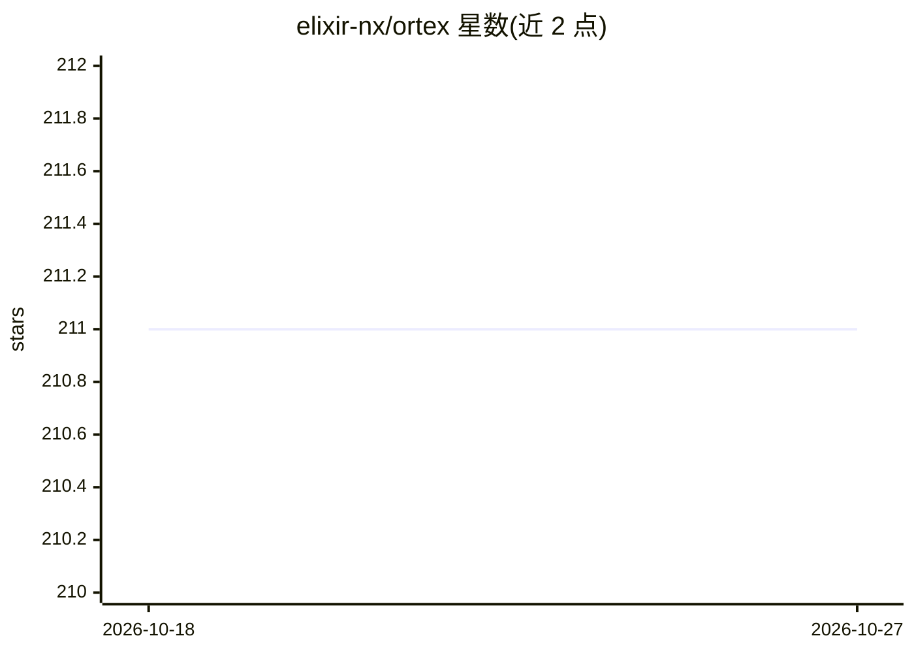

# elixir-nx/ortex

⭐ 211 · Elixir · MIT · 推送 2026-02-10 · [GitHub](https://github.com/elixir-nx/ortex) · 组织维护

**Elixir 的 ONNX Runtime 绑定库：加载运行 ONNX 模型推理**

对 ort（ONNX Runtime 的 Rust 绑定）做的 Elixir 封装，可加载 ONNX 模型并执行推理，支持 CUDA、TensorRT、Core ML、ARM Compute Library 等 ONNX Runtime 后端。实现 Nx.Serving behaviour，使模型可在应用监督树中并发、分布式地部署运行；另提供 storage-only 张量实现。通过 mix.exs 添加依赖安装，编译需 Rust 工具链。给在 Elixir 生态中部署 ONNX 模型的开发者使用。

## 筛选速览

| 维度 | 判定 | 备注 |
|---|---|---|
| AI 角色 | `ai-ecosystem` | LLM/agent 周边工具 |
| 许可风险 | `permissive` | MIT |
| 部署形态 | `None` |  |
| 模型依赖 | — | README 未给出锁定关系 |
| 硬件要求 | — | 无带数字的原话,不猜 |
| 安装摩擦 | `medium` | 含编译或系统依赖之一 |
| 成熟度 | — | 结构信号不足 |

## 能力要点

- 加载并推理 ONNX 模型（可从 PyTorch/TensorFlow 导出）
- 支持 CUDA、TensorRT、Core ML、ARM Compute Library 后端
- 实现 Nx.Serving，支持并发与集群分布式部署

## 适用场景

- 在 Elixir 应用中加载 ONNX 模型做推理
- 通过 Nx.Serving 在集群中并发部署模型服务
- 在不同硬件后端上运行导出的深度学习模型

## 场景标签

`推理引擎` · 领域:训练与推理

## 证据(README 行号)

> L3: `Ortex` is a wrapper around ONNX Runtime (implemented as
> L5: `Nx.Serving` to easily deploy ONNX models

## 星数曲线

2026-10-18 211 → 2026-10-27 211（+0）

---
*卡片 v1 · prompt 1.4 · 生成 2026-10-22 · 置信度 high · 依据 README sha `1bcfd4fc432e` · [字段定义](../../DATASET.md)*
