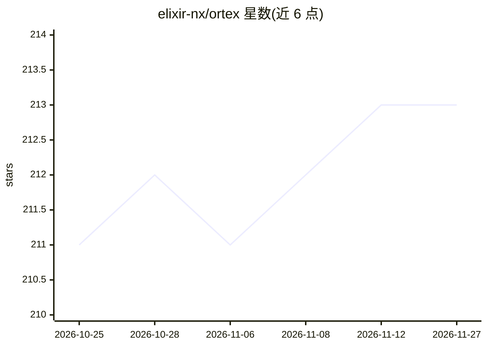

# elixir-nx/ortex

⭐ 213 · Elixir · MIT · 推送 2026-11-09 · [GitHub](https://github.com/elixir-nx/ortex) · 组织维护

**Elixir 的 ONNX Runtime 绑定：在 BEAM 应用中加载并运行 ONNX 推理**

Ortex 是 ONNX Runtime 的 Elixir 封装，基于 ort 实现绑定，提供模型加载与推理能力，并实现 Nx.Serving 行为以在监督树中并发、分布式地部署 ONNX 模型。附带的 storage-only 张量实现简化输入输出处理。支持通过 ONNX Runtime 的 CUDA、TensorRT、Core ML、ARM Compute Library 等后端运行。安装方式为在 mix.exs 中添加依赖；编译需要 Rust，且 cuda/tensorrt 等动态链接构建当前需使用 Rust 1.99。

## 筛选速览

| 维度 | 判定 | 备注 |
|---|---|---|
| AI 角色 | `ai-ecosystem` | LLM/agent 周边工具 |
| 许可风险 | `permissive` | MIT |
| 部署形态 | `None` |  |
| 模型依赖 | — | README 未给出锁定关系 |
| 硬件要求 | — | 无带数字的原话,不猜 |
| 安装摩擦 | `medium` | 含编译或系统依赖之一 |
| 成熟度 | — | 结构信号不足 |

## 能力要点

- 加载 ONNX 模型并执行推理，模型可由 PyTorch、TensorFlow 等库导出
- 实现 Nx.Serving 行为，支持并发与集群分布式部署
- 可选用 CUDA、TensorRT、Core ML、ARM Compute Library 等后端
- 提供 storage-only 张量实现便于使用

## 适用场景

- 在 Elixir/Phoenix 应用中部署 ONNX 格式的机器学习模型
- 用 Nx.Serving 在监督树中并发处理推理请求
- 在集群中分布式运行 ONNX 推理

## 场景标签

`推理引擎` · 领域:训练与推理

## 证据(README 行号)

> L3: `Ortex` is a wrapper around ONNX Runtime (implemented as
> L5: `Nx.Serving` to easily deploy ONNX models
> L10: libraries like PyTorch and TensorFlow. Ortex allows for easy loading and fast inference of

## 星数曲线

2026-10-25 211 → 2026-11-27 213（+2）

---
*卡片 v1 · prompt 1.4 · 生成 2026-11-25 · 置信度 high · 依据 README sha `572a3c70efea` · [字段定义](../../DATASET.md)*
