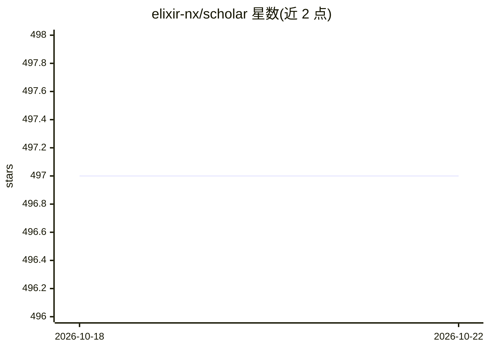

# elixir-nx/scholar

⭐ 497 · Elixir · Apache-2.0 · 推送 2026-10-21 · [GitHub](https://github.com/elixir-nx/scholar) · 组织维护

**Elixir 传统机器学习库：基于 Nx 的分类/回归/聚类算法**

Erlang 生态基金会机器学习工作组维护的 Elixir 传统机器学习库，构建于数值计算库 Nx 之上，提供分类、回归、聚类、降维、指标计算与预处理的算法实现；深度学习部分由 Axon 承担。安装方式为 mix.exs 依赖引入（~> 0.3.0），需配置 Nx 编译器/后端（如 EXLA），多数算法含循环、依赖 JIT 编译以提升内存效率；EXLA 客户端可设为 :host/:cuda/:rocm。也支持在代码 Notebook 中用 Mix.install 使用。

## 筛选速览

| 维度 | 判定 | 备注 |
|---|---|---|
| AI 角色 | `ai-native` | 本体是模型或模型工具 |
| 许可风险 | `permissive` | Apache-2.0 |
| 部署形态 | `None` |  |
| 模型依赖 | — | README 未给出锁定关系 |
| 硬件要求 | — | 无带数字的原话,不猜 |
| 安装摩擦 | `medium` | 含编译或系统依赖之一 |
| 成熟度 | — | 结构信号不足 |

## 能力要点

- 基于 Nx 实现分类、回归、聚类、降维、指标与预处理算法
- 支持 EXLA 后端与 JIT 编译，客户端可配置 :cuda/:rocm
- 支持 Mix 项目依赖与 Notebook 两种使用方式

## 适用场景

- 在 Elixir 项目中直接使用传统机器学习算法
- 在 Livebook 等 Notebook 环境中做数据分析与建模
- 与 Axon 配合覆盖从传统 ML 到深度学习的需求

## 场景标签

 · 领域:机器学习库

## 证据(README 行号)

> L3: Traditional machine learning tools built on top of Nx. Scholar implements
> L5: reduction, metrics, and preprocessing. For deep learning, see

## 星数曲线

2026-10-18 497 → 2026-10-22 497（+0）

---
*卡片 v1 · prompt 1.4 · 生成 2026-10-21 · 置信度 high · 依据 README sha `13a0573ff1e3` · [字段定义](../../DATASET.md)*
