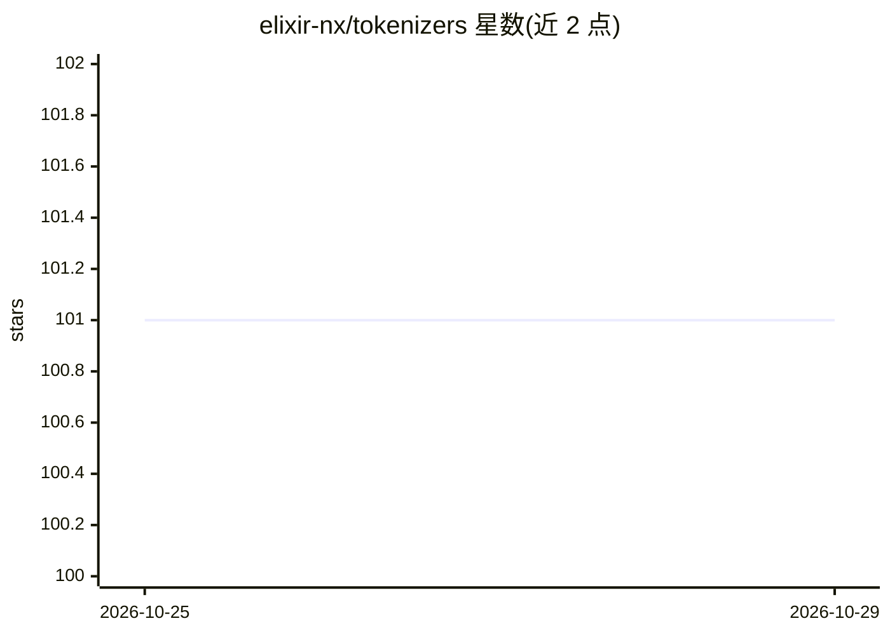

# elixir-nx/tokenizers

⭐ 101 · Elixir · Apache-2.0 · 推送 2026-10-24 · [GitHub](https://github.com/elixir-nx/tokenizers) · [官网](https://hexdocs.pm/tokenizers) · 组织维护

**Elixir 语言绑定：在 Elixir 中使用 Hugging Face Tokenizers**

为 Hugging Face Tokenizers（Rust 实现）提供 Elixir 绑定：通过 mix.exs 添加依赖或 Mix.install 安装，可加载 Hugging Face Hub 上任意模型仓库的预训练分词器（如 bert-base-cased），执行文本编码并读取 token 与 id。附有 Livebook 介绍笔记本演示 API 用法。面向在 Elixir 生态中做 NLP/机器学习文本预处理的开发者。

## 筛选速览

| 维度 | 判定 | 备注 |
|---|---|---|
| AI 角色 | `ai-ecosystem` | LLM/agent 周边工具 |
| 许可风险 | `permissive` | Apache-2.0 |
| 部署形态 | `None` |  |
| 模型依赖 | — | README 未给出锁定关系 |
| 硬件要求 | — | 无带数字的原话,不猜 |
| 安装摩擦 | `low` | 无编译、无系统依赖或容器化 |
| 成熟度 | — | 结构信号不足 |

## 能力要点

- 加载 Hugging Face Hub 任意模型仓库的预训练分词器
- 提供 encode 编码及 tokens/ids 读取 API
- 支持 mix.exs 依赖与 Livebook/IEx 的 Mix.install 两种安装方式
- 附介绍性 Livebook 笔记本

## 适用场景

- 在 Elixir 项目中对文本做模型分词预处理
- 在 Livebook 中交互式体验分词器 API

## 场景标签

 · 领域:NLP/机器学习工具库

## 证据(README 行号)

> L5: Elixir bindings for Hugging Face Tokenizers.
> L29: You can use any pre-trained tokenizer from any model repo on Hugging Face Hub, such as bert-base-cased.

## 星数曲线

2026-10-25 101 → 2026-10-29 101（+0）

---
*卡片 v1 · prompt 1.4 · 生成 2026-10-24 · 置信度 high · 依据 README sha `8b239733271d` · [字段定义](../../DATASET.md)*
