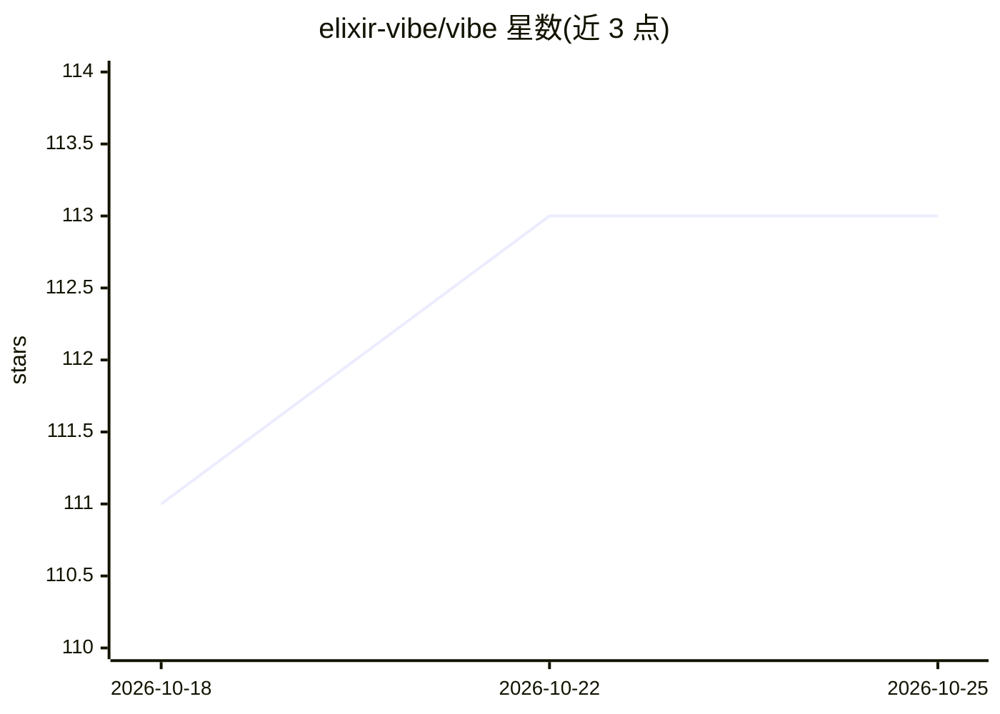

# elixir-vibe/vibe

⭐ 113 · Elixir · MIT · 推送 2026-06-11 · [GitHub](https://github.com/elixir-vibe/vibe) · [官网](https://hexdocs.pm/vibe) · 组织维护

**面向 Elixir/OTP 项目的 BEAM 原生编码 agent（终端+Web）**

以本地 OTP 应用形式运行的编码 agent，提供 TUI、Phoenix LiveView Web 控制台、持久会话、插件、技能、子 agent 与项目感知的 Elixir eval。会话、命令作业、子 agent 等均为受监督的 OTP 进程，可监控/取消/恢复；支持通过 SSH 与 Erlang distribution 接入远程节点。模型接入通过 ReqLLM 传递 provider:model 字符串，运行状态存于本地 SQLite。README 自声明为实验性、非生产就绪，agent 可在机器上执行操作。安装方式为 Hex escript 或源码编译，需 Elixir 1.19+ 与 Erlang/OTP 27+。

## 筛选速览

| 维度 | 判定 | 备注 |
|---|---|---|
| AI 角色 | `ai-native` | 本体是模型或模型工具 |
| 许可风险 | `permissive` | MIT |
| 部署形态 | `None` |  |
| 模型依赖 | — | README 未给出锁定关系 |
| 硬件要求 | — | 无带数字的原话,不猜 |
| 安装摩擦 | `low` | 无编译、无系统依赖或容器化 |
| 成熟度 | `idea` | |

## 能力要点

- Elixir eval 作为控制平面，暴露 Cmd/Web/Goal 等有状态 API
- 会话、命令、插件、子 agent 均为受监督的 OTP 进程
- 子 agent 拥有独立会话与生命周期，支持并行/后台工作
- TUI 与 LiveView Web 控制台共享同一后台服务器与会话进程

## 适用场景

- 在终端或浏览器中让 AI agent 检查、修改 Elixir 项目代码
- 通过子 agent 并行开展研究与后台任务
- 跨机器通过 SSH/Erlang distribution 接入远程节点协同工作

## 场景标签

`编码 Agent` · 领域:编码与开发

## 证据(README 行号)

> L3: BEAM-native coding agent for Elixir/OTP projects.
> L5: Vibe is a terminal/web coding agent that runs as a local OTP application. It includes a TUI, a LiveView web console,

## 星数曲线

2026-10-18 111 → 2026-10-25 113（+2）

---
*卡片 v1 · prompt 1.4 · 生成 2026-10-23 · 置信度 high · 依据 README sha `37266fa3329a` · [字段定义](../../DATASET.md)*
