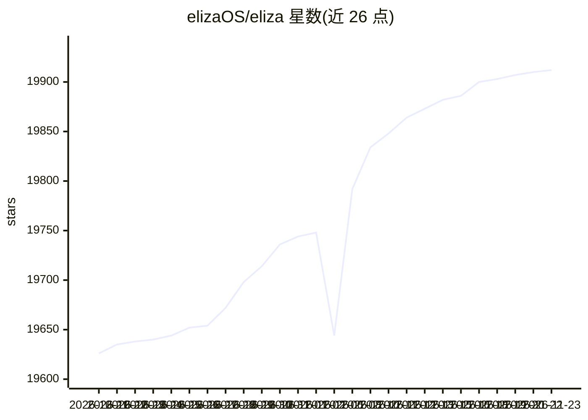

# elizaOS/eliza

⭐ 19,912 · Java · MIT · 推送 2026-11-22 · [GitHub](https://github.com/elizaOS/eliza) · [官网](https://elizaresearch.ai/) · 组织维护

**给开发者的 agent 操作系统规范：Eliza v4 在 Vibestack 上的形式化工程**

该仓库是 Eliza v4 on Vibestack 的规范工作区，覆盖内核、agent 宿主、设备镜像、云服务与助手插件：agent 运行在设备端，云端提供身份、计费与模型访问。规范包含需求、Quint 模型及 VibeLang 与 Effect 的生成契约。工作流为 pnpm 生成、检查模型轨迹与回放、证明安全义务并记录审查（pnpm accept），各包 shell 由其已接受规范实现。另含 Android Keystore 密码恢复测试夹具（Android 15+ 模拟器、gradle 安装测试 APK、vitest 聚焦旅程）。

## 筛选速览

| 维度 | 判定 | 备注 |
|---|---|---|
| AI 角色 | `ai-ecosystem` | LLM/agent 周边工具 |
| 许可风险 | `permissive` | MIT |
| 部署形态 | `library` | 以包/库形式分发 |
| 模型依赖 | — | README 未给出锁定关系 |
| 硬件要求 | — | 无带数字的原话,不猜 |
| 安装摩擦 | `low` | 无编译、无系统依赖或容器化 |
| 成熟度 | — | 结构信号不足 |

## 动量与使用信号

- 维护:`active` — 距上次 push 1.1 天,年发版 17,159 位贡献者
- 涨星:近 1 天 **+2**(自 20261016 起算)
- 下载:GitHub Release 附件 累计 144,967(17 个 release)
- 平台:LINUX / ANDROID / WEB · 协议:—

## 能力要点

- 规范覆盖内核、agent 宿主、设备镜像、云服务与助手插件
- 设备端运行 agent，云端提供身份、计费与模型访问
- pnpm check 生成契约、检查轨迹回放并证明安全义务
- Android 密码备份/恢复测试夹具（Keystore + PGlite Cloud Worker）

## 适用场景

- 按规范构建或验证 Eliza v4 各包的实现
- 验证 Android 密码备份与新设备恢复流程
- 基于 accepted specification 生成各包 shell 实现

## 场景标签

`多智能体` `Agent 框架` · 领域:Agent 开发

## 证据(README 行号)

> L3: This workspace specifies Eliza v4 on Vibestack: the kernel, the agent host,
> L4: the device image, the cloud services and the assistant plugins. Agents run
> L5: on the device; the cloud serves identity, billing and model access. The

## 星数曲线

2026-10-21 19,626 → 2026-11-23 19,912（+286）

---
*卡片 v1 · prompt 1.4 · 生成 2026-11-23 · 置信度 mid · 依据 README sha `3e54b0d40f98` · [字段定义](../../DATASET.md)*
