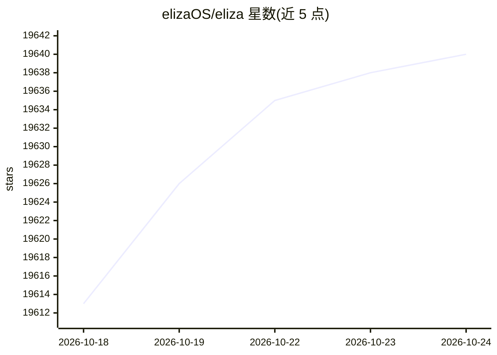

# elizaOS/eliza

⭐ 19,640 · TypeScript · MIT · 推送 2026-10-23 · [GitHub](https://github.com/elizaOS/eliza) · [官网](https://elizaresearch.ai/) · 组织维护

**面向开发者的自主 AI agent 开源 TypeScript 框架与产品栈**

以 monorepo 形式提供：核心运行时、Eliza 应用（web/桌面/移动）、CLI、云服务、原生桥接与第一方插件。运行时模型无关，通过插件注册 actions、providers、evaluators、services、model handlers 等组件；应用能力覆盖聊天、语音、记忆、知识、消息连接器、浏览器与桌面自动化、EVM/Solana 钱包操作等，实际可用性取决于操作系统、已装插件与配置的模型/服务商。另含可引导的 Linux 与 AOSP 发行版工具链及本地推理路径（Eliza-1，基于 Gemma 4 的 2B–27B 档位）。

## 筛选速览

| 维度 | 判定 | 备注 |
|---|---|---|
| AI 角色 | `ai-native` | 本体是模型或模型工具 |
| 许可风险 | `permissive` | MIT |
| 部署形态 | `None` |  |
| 模型依赖 | — | README 未给出锁定关系 |
| 硬件要求 | — | 无带数字的原话,不猜 |
| 安装摩擦 | `low` | 无编译、无系统依赖或容器化 |
| 成熟度 | — | 结构信号不足 |

## 动量与使用信号

- 维护:`active` — 距上次 push 1.1 天,年发版 17,159 位贡献者
- 涨星:近 1 天 **+2**(自 20261016 起算)
- 下载:GitHub Release 附件 累计 144,967(17 个 release)
- 平台:LINUX / ANDROID / WEB · 协议:—

## 能力要点

- 模型无关运行时 @elizaos/core，插件可注册 actions/providers/evaluators/services/model handlers 等
- 本地推理路径含 2B/4B/9B/27B 模型档位及本地嵌入、语音、视觉、图像生成资产
- 按能力将模型请求路由到本地、直连服务商或 Eliza Cloud 三类后端
- 提供可引导的 Linux 与 AOSP 发行版（packages/os）

## 适用场景

- 从源码运行并开发自有 agent 或插件
- 构建覆盖聊天、语音、知识与设备桥接的个人助理应用
- 把整台设备作为 elizaOS 运行（Linux/AOSP 发行版）

## 场景标签

`Agent 框架` `多智能体` `AI 助手` `聊天机器人` · 领域:Agent 开发

## 证据(README 行号)

> L10: elizaOS is an open-source TypeScript framework and product stack for autonomous
> L90: The framework is model-agnostic and extended through plugins:
> L108: `@elizaos/plugin-local-inference` provides the

## 星数曲线

2026-10-18 19,613 → 2026-10-24 19,640（+27）

---
*卡片 v1 · prompt 1.4 · 生成 2026-10-18 · 置信度 high · 依据 README sha `70b9e04008c4` · [字段定义](../../DATASET.md)*
