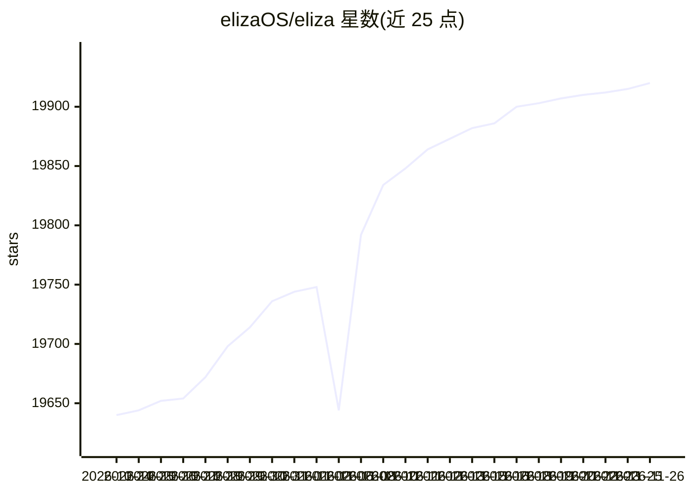

# elizaOS/eliza

⭐ 19,920 · Java · MIT · 推送 2026-11-25 · [GitHub](https://github.com/elizaOS/eliza) · [官网](https://elizaresearch.ai/) · 组织维护

**面向开发者的 agentic 操作系统规范与运行时（Eliza v4 on Vibestack）**

该仓库定义 Eliza v4 on Vibestack 的规格说明，覆盖内核、agent 宿主、设备镜像、云服务与助手插件；agent 在设备端运行，云端提供身份、计费与模型访问。规格包含需求、Quint 模型及 VibeLang 和 Effect 实现的生成契约。构建要求 Node 26 与 pnpm 10.24.0，通过 pnpm gen/check/verify 生成契约、检查模型轨迹、验证安全义务；另含基于 Android Keystore 与 PGlite Cloud Worker 的 Android 密码恢复测试夹具。

## 筛选速览

| 维度 | 判定 | 备注 |
|---|---|---|
| AI 角色 | `ai-ecosystem` | LLM/agent 周边工具 |
| 许可风险 | `permissive` | MIT |
| 部署形态 | `library` | 以包/库形式分发 |
| 模型依赖 | — | README 未给出锁定关系 |
| 硬件要求 | — | 无带数字的原话,不猜 |
| 安装摩擦 | `low` | 无编译、无系统依赖或容器化 |
| 成熟度 | — | 结构信号不足 |

## 动量与使用信号

- 维护:`active` — 距上次 push 1.1 天,年发版 17,159 位贡献者
- 涨星:近 1 天 **+2**(自 20261016 起算)
- 下载:GitHub Release 附件 累计 144,967(17 个 release)
- 平台:LINUX / ANDROID / WEB · 协议:—

## 能力要点

- 规格化覆盖内核、agent 宿主、设备镜像、云服务与助手插件
- 设备端运行 agent，云端提供身份、计费与模型访问
- Quint 模型与生成的 VibeLang/Effect 契约，pnpm check 做模型轨迹检查与安全义务证明
- Android Keystore 密码恢复测试夹具（Android 15+ 模拟器）

## 适用场景

- 按规格构建运行在设备端的 Eliza agent
- 验证 agent 系统的安全义务与模型轨迹
- 测试 Android 设备上的密码备份与恢复流程

## 场景标签

`Agent 框架` `多智能体` · 领域:Agent 开发

## 证据(README 行号)

> L3: This workspace specifies Eliza v4 on Vibestack: the kernel, the agent host,
> L5: on the device; the cloud serves identity, billing and model access. The

## 星数曲线

2026-10-24 19,640 → 2026-11-26 19,920（+280）

---
*卡片 v1 · prompt 1.4 · 生成 2026-11-24 · 置信度 low · 依据 README sha `713b0a39877c` · [字段定义](../../DATASET.md)*
