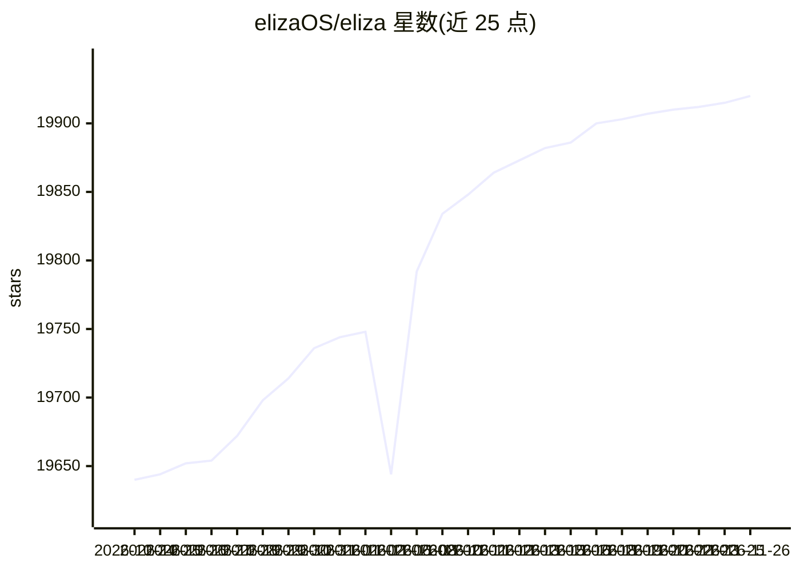

# elizaOS/eliza

⭐ 19,920 · Java · MIT · 推送 2026-11-25 · [GitHub](https://github.com/elizaOS/eliza) · [官网](https://elizaresearch.ai/) · 组织维护

**面向开发者的开源 agentic 操作系统：agent 运行内核与插件框架**

Eliza v4 on Vibestack 的规格化仓库，覆盖 kernel、agent host、device image、cloud services 与 assistant plugins；agent 在设备端运行，云端负责 identity、billing 与 model access。规格包含 requirements、Quint 模型及 VibeLang/Effect 生成的 contracts。使用 Node 26、pnpm 10.24.0 与 Dafny 4.11，通过 pnpm 脚本生成 contracts、检查模型轨迹、证明安全义务并运行 journeys，经 pnpm accept 记录评审后实现各 package 的 shell。含 Android Keystore 密码恢复测试 fixture。

## 筛选速览

| 维度 | 判定 | 备注 |
|---|---|---|
| AI 角色 | `ai-ecosystem` | LLM/agent 周边工具 |
| 许可风险 | `permissive` | MIT |
| 部署形态 | `library` | 以包/库形式分发 |
| 模型依赖 | — | README 未给出锁定关系 |
| 硬件要求 | — | 无带数字的原话,不猜 |
| 安装摩擦 | `low` | 无编译、无系统依赖或容器化 |
| 成熟度 | — | 结构信号不足 |

## 动量与使用信号

- 维护:`active` — 距上次 push 1.1 天,年发版 17,159 位贡献者
- 涨星:近 1 天 **+2**(自 20261016 起算)
- 下载:GitHub Release 附件 累计 144,967(17 个 release)
- 平台:LINUX / ANDROID / WEB · 协议:—

## 能力要点

- agent 在设备端运行，云端提供 identity、billing 与 model access
- 基于 Quint 模型与生成 contracts 的规格驱动开发流程
- pnpm check 验证模型轨迹、安全义务证明与 journeys
- 提供 Android Keystore 与 PGlite Cloud Worker 的密码备份/恢复 fixture

## 适用场景

- 构建并验证运行在设备端的自主 agent
- 通过规格生成 contracts 并进行形式化安全验证
- 测试跨设备的密码 vault 备份与恢复流程

## 场景标签

`Agent 框架` · 领域:Agent 开发

## 证据(README 行号)

> L3: This workspace specifies Eliza v4 on Vibestack: the kernel, the agent host,
> L5: on the device; the cloud serves identity, billing and model access. The

## 星数曲线

2026-10-24 19,640 → 2026-11-26 19,920（+280）

---
*卡片 v1 · prompt 1.4 · 生成 2026-11-26 · 置信度 mid · 依据 README sha `df2e9ba79ac3` · [字段定义](../../DATASET.md)*
