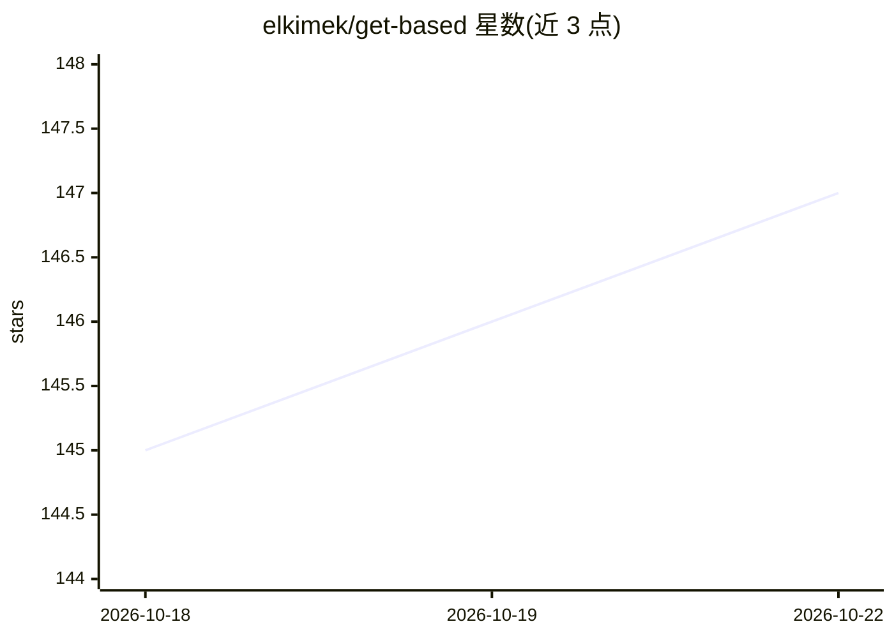

# elkimek/get-based

⭐ 148 · TypeScript · AGPL-3.0 · 推送 2026-10-22 · [GitHub](https://github.com/elkimek/get-based) · [官网](https://getbased.health) · 个人维护

**本地优先的个人健康仪表盘：化验、DNA、可穿戴与光照数据整合**

开源、本地优先的浏览器端健康工作台：导入化验报告、原始 DNA、可穿戴数据、体测与光照/UV/EMF 记录，提供趋势、计算指标、Biology Scores 与分档案报告。AI 为可选路径，支持 OpenRouter、本地 OpenAI 兼容服务器等多种接入，语音可本机运行。数据默认存于浏览器存储，可加密同步与密码保护分享；PWA 可离线使用。使用 Node.js 24 与 SvelteKit 构建静态产物。声明不替代医疗诊断。

## 筛选速览

| 维度 | 判定 | 备注 |
|---|---|---|
| AI 角色 | `ai-enhanced` | 去掉 AI 部分产品仍成立 |
| 许可风险 | `viral` | AGPL-3.0 |
| 部署形态 | `None` |  |
| 模型依赖 | — | README 未给出锁定关系 |
| 硬件要求 | — | 无带数字的原话,不猜 |
| 安装摩擦 | `low` | 无编译、无系统依赖或容器化 |
| 成熟度 | — | 结构信号不足 |

## 能力要点

- 导入化验/DNA/可穿戴/光照等数据并计算 Biology Scores
- 本地优先：数据默认存浏览器存储，可加密同步与受保护分享
- 可选 AI 路径：OpenRouter、本地 OpenAI 兼容服务器、CLI agents 等
- 无渲染后端：构建产物为静态分发，PWA 支持离线

## 适用场景

- 集中管理个人化验、DNA 与可穿戴数据并查看趋势
- 在不上传数据的前提下用本地 AI 解读健康记录
- 以加密方式跨设备同步或与医生分享健康档案

## 场景标签

 · 领域:健康/生物标志物追踪

## 证据(README 行号)

> L3: **getbased** is an open-source, local-first health dashboard. Bring labs, DNA,
> L17: - Ask optional AI questions using selected health context, your documents and interpretive lenses. Voice can run on
> L53: Normal tracking works without AI. Supported AI paths include PPQ, Routstr,

## 星数曲线

2026-10-18 145 → 2026-10-22 147（+2）

---
*卡片 v1 · prompt 1.4 · 生成 2026-10-22 · 置信度 high · 依据 README sha `3aa152d385e7` · [字段定义](../../DATASET.md)*
