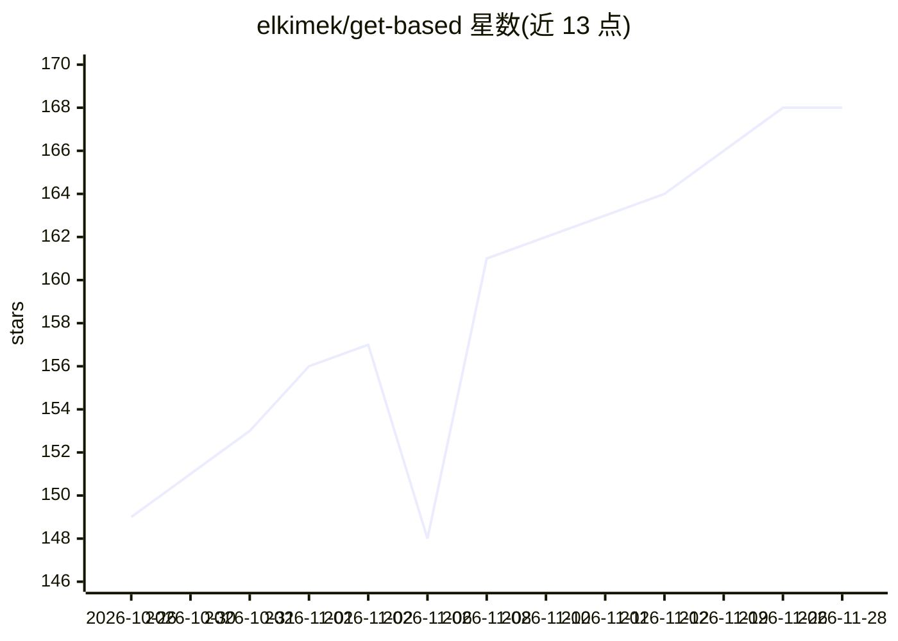

# elkimek/get-based

⭐ 168 · TypeScript · AGPL-3.0 · 推送 2026-11-27 · [GitHub](https://github.com/elkimek/get-based) · [官网](https://getbased.health) · 个人维护

**本地优先的个人健康仪表盘，整合化验、DNA、可穿戴与可选 AI 分析**

getbased 是开源、本地优先的健康仪表盘 PWA，数据默认存于浏览器存储，无需账号。用户可导入化验报告（数值、单位、参考范围）、原始 DNA、可穿戴数据、体测与光照记录，查看趋势与 Biology Scores。可选功能包括：基于所选健康上下文与文档的 AI 问答、端侧或远程语音、知识库索引、加密同步与密码保护分享、Agent Access。声明 Biology Scores 与 AI 解释仅支持学习与健康用途，不替代医疗诊断。支持 Vercel/Cloudflare Pages 部署或 Node.js 本地运行。

## 筛选速览

| 维度 | 判定 | 备注 |
|---|---|---|
| AI 角色 | `ai-enhanced` | 去掉 AI 部分产品仍成立 |
| 许可风险 | `viral` | AGPL-3.0 |
| 部署形态 | `library` | 以包/库形式分发 |
| 模型依赖 | — | README 未给出锁定关系 |
| 硬件要求 | — | 无带数字的原话,不猜 |
| 安装摩擦 | `low` | 无编译、无系统依赖或容器化 |
| 成熟度 | — | 结构信号不足 |

## 能力要点

- 化验、DNA、可穿戴、光照、生活方式记录整合到单一浏览器工作区
- 可选 AI：远程激活前标识目的地并请求批准，语音可端侧运行
- 配置文件加密同步、密码保护分享与本地知识库索引
- 纯 PWA，无终端的 Vercel/Cloudflare 一键部署，AGPL-3.0-or-later 许可

## 适用场景

- 把多次化验报告的趋势和自算指标放在本地统一查看
- 结合 DNA 与可穿戴数据记录生活方式与补充剂历史
- 在自托管部署中用本地 OpenAI 兼容服务做健康语境问答
- 生成独立档案并为家人创建定制健康报告

## 场景标签

`文档问答` · 领域:知识与检索

## 证据(README 行号)

> L3: **getbased** is an open-source, local-first health dashboard. Bring labs, DNA,
> L54: Normal tracking works without AI. Supported AI paths include PPQ, Routstr,
> L71: **getbased** is a pure PWA: all health records stay in your own browser storage, and you can run your own private H

## 星数曲线

2026-10-26 149 → 2026-11-28 168（+19）

---
*卡片 v1 · prompt 1.4 · 生成 2026-11-28 · 置信度 high · 依据 README sha `d11aeb8820fb` · [字段定义](../../DATASET.md)*
