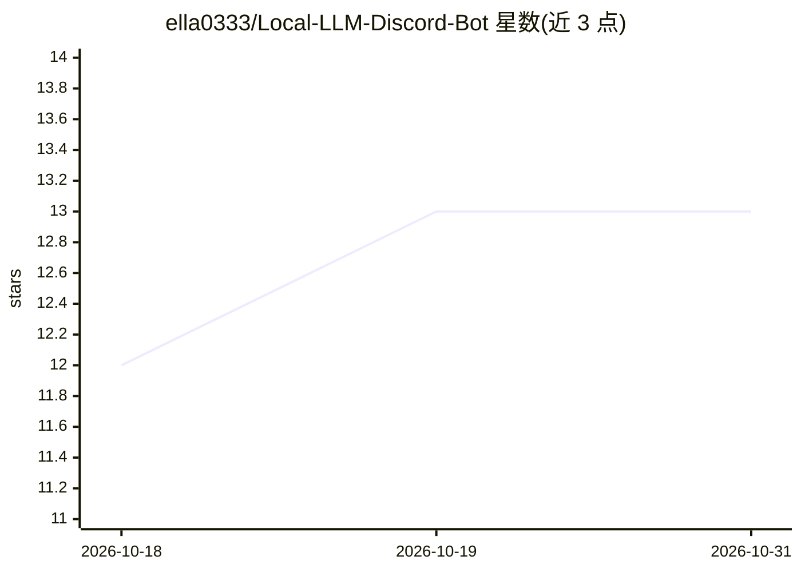

# ella0333/Local-LLM-Discord-Bot

⭐ 13 · Python · MIT · 推送 2026-05-28 · [GitHub](https://github.com/ella0333/Local-LLM-Discord-Bot) · 个人维护

**把本地 LLM（Ollama/LM Studio）接入 Discord 随时对话的机器人**

基于 discord.py 的 Discord 机器人，将本机 Ollama 或 LM Studio 运行的 LLM 通过 Discord 暴露给手机、平板等设备使用。支持 DM 与服务器内提及对话、用户白名单、可选 OpenAI 内容审核、视觉模型图片输入、会话记忆与上下文管理，并可保存聊天记录与用户反馈用于微调数据集和 RLHF。需 Windows PC、Python 3.10+、已装 Ollama 或 LM Studio 及 Discord 账号，通过 git clone 与 pip 安装依赖后运行 main.py，由设置向导完成配置。

## 筛选速览

| 维度 | 判定 | 备注 |
|---|---|---|
| AI 角色 | `ai-native` | 本体是模型或模型工具 |
| 许可风险 | `permissive` | MIT |
| 部署形态 | `library` | 以包/库形式分发 |
| 模型依赖 | local-ok | 支持本地模型 |
| 硬件要求 | — | 无带数字的原话,不猜 |
| 安装摩擦 | `low` | 无编译、无系统依赖或容器化 |
| 成熟度 | — | 结构信号不足 |

## 能力要点

- 连接 Ollama 与 LM Studio 的本地 LLM 作为对话后端
- 用户白名单控制访问、可选 OpenAI 内容审核
- 支持视觉模型的图片输入
- 聊天记录保存与 RLHF 反馈收集用于微调数据集

## 适用场景

- 在手机上通过 Discord 随时使用家中运行的本地 LLM
- 限定白名单成员私享自己的本地模型
- 收集对话与用户反馈构建微调/RLHF 数据集

## 场景标签

`聊天机器人` · 领域:对话与助手

## 证据(README 行号)

> L3: 🤖 Chat with your local LLM through Discord! Access your Ollama or LM Studio LLM from your phone, tablet, or any devi
> L7: - 🦙 **Works with Ollama & LM Studio** - Use your favorite local LLM

## 星数曲线

2026-10-18 12 → 2026-10-31 13（+1）

---
*卡片 v1 · prompt 1.4 · 生成 2026-10-31 · 置信度 mid · 依据 README sha `4c68b73ae84b` · [字段定义](../../DATASET.md)*
